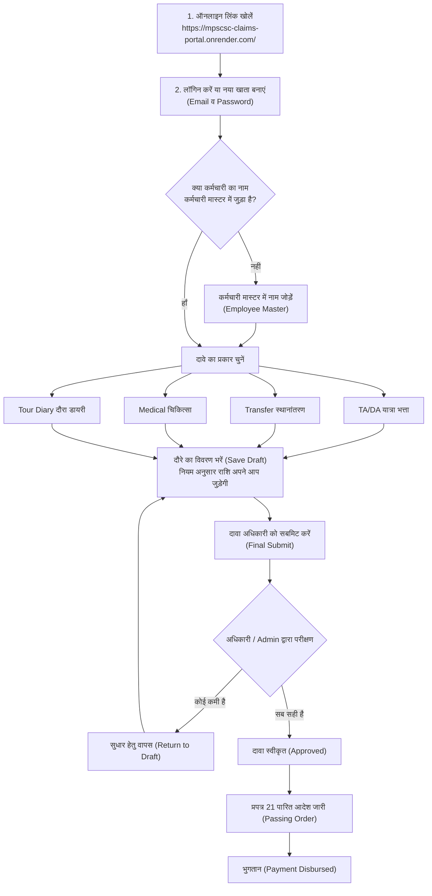

# MPSCSC लाइव दावा पोर्टल — आसान ऑनलाइन उपयोगकर्ता गाइड
# MPSCSC Live Claims Portal — Easy Online User Guide

---

> **वेबसाइट लिंक / Live Portal URL:** **[https://mpscsc-claims-portal.onrender.com/](https://mpscsc-claims-portal.onrender.com/)**  
> **संस्था / Organisation:** म.प्र. राज्य नागरिक आपूर्ति निगम (MPSCSC Ltd.)  
> **प्रणाली / System:** ऑनलाइन यात्रा, स्थानांतरण, चिकित्सा दावा एवं दौरा डायरी पोर्टल  
> **लक्षित उपयोगकर्ता / Users:** सभी अधिकारी, शाखा प्रभारी, जिला प्रबंधक, लेखा स्टाफ एवं कर्मचारी  
> **भाषा / Language:** सरल हिन्दी + Simple English (आसान बोलचाल की भाषा)

---

## विषय-सूची / Table of Contents

1. [पोर्टल का ऑनलाइन उपयोग एवं जरूरी सूचना (Online Access & First Visit)](#1-पोर्टल-का-ऑनलाइन-उपयोग-एवं-जरूरी-सूचना-online-access--first-visit)
2. [प्रक्रिया फ्लोचार्ट — एक नज़र में (Workflow Flowchart)](#2-प्रक्रिया-फ्लोचार्ट--एक-नज़र-में-workflow-flowchart)
3. [मॉड्यूल 1: ऑनलाइन लॉगिन और पासवर्ड (Login & Password)](#3-मॉड्यूल-1-ऑनलाइन-लॉगिन-और-पासवर्ड-login--password)
4. [मॉड्यूल 2: मुख्य डैशबोर्ड (Dashboard Overview)](#4-मॉड्यूल-2-मुख्य-डैशबोर्ड-dashboard-overview)
5. [मॉड्यूल 3: कर्मचारी मास्टर — सबसे पहला और जरूरी काम (Employee Master)](#5-मॉड्यूल-3-कर्मचारी-मास्टर--सबसे-पहला-और-जरूरी-काम-employee-master)
6. [मॉड्यूल 4: यात्रा भत्ता दावा और प्रपत्र 21 बिल (TA/DA Claims & Form 21 Bill)](#6-मॉड्यूल-4-यात्रा-भत्ता-दावा-और-प्रपत्र-21-बिल-tada-claims--form-21-bill)
7. [मॉड्यूल 5: शासकीय दौरा डायरी (Official Tour Diary)](#7-मॉड्यूल-5-शासकीय-दौरा-डायरी-official-tour-diary)
8. [मॉड्यूल 6: स्थानांतरण दावा (Transfer Claim)](#8-मॉड्यूल-6-स्थानांतरण-दावा-transfer-claim)
9. [मॉड्यूल 7: चिकित्सा प्रतिपूर्ति दावा (Medical Claim)](#9-मॉड्यूल-7-चिकित्सा-प्रतिपूर्ति-दावा-medical-claim)
10. [मॉड्यूल 8: सभी दावे और एक्सेल रिपोर्ट (All Claims & Reports)](#10-मॉड्यूल-8-सभी-दावे-और-एक्सेल-रिपोर्ट-all-claims--reports)
11. [मॉड्यूल 9: अधिकारी / व्यवस्थापक के कार्य (Admin Features)](#11-मॉड्यूल-9-अधिकारी--व्यवस्थापक-के-कार्य-admin-features)
12. [मॉड्यूल 10: अक्सर पूछे जाने वाले सवाल (FAQ & Troubleshooting)](#12-मॉड्यूल-10-अक्सर-पूछे-जाने-वाले-सवाल-faq--troubleshooting)

---

## 1. पोर्टल का ऑनलाइन उपयोग एवं जरूरी सूचना (Online Access & First Visit)

### ऑनलाइन लिंक कैसे खोलें? (How to Open)
1. अपने मोबाइल, लैपटॉप या कार्यालय के कंप्यूटर पर कोई भी ब्राउज़र (जैसे **Google Chrome** या **Microsoft Edge**) खोलें।
2. एड्रेस बार में यह लिंक लिखें या सीधे क्लिक करें:  
   👉 **[https://mpscsc-claims-portal.onrender.com/](https://mpscsc-claims-portal.onrender.com/)**
3. आपको अपने कंप्यूटर में कोई भी सॉफ्टवेयर या फाइल डाउनलोड करने की आवश्यकता नहीं है।

---

> [!IMPORTANT]
> **पहली बार लिंक खोलने पर विशेष ध्यान दें (Cold Start Notice):**
> यह पोर्टल रेंडर क्लाउड (Render Cloud) पर लाइव 24x7 होस्ट है। यदि पिछले 15-20 मिनट से किसी ने पोर्टल नहीं खोला होता है, तो क्लाउड सर्वर स्लीप मोड (Sleep Mode) में चला जाता है।
> - इसलिए पहली बार लिंक खोलने पर पेज लोड होने में **30 से 50 सेकंड** का समय लग सकता है।
> - **कृपया घबराएं नहीं और पेज को बार-बार रिफ्रेश न करें।** 30-40 सेकंड में सर्वर जाग जाएगा और पोर्टल तेजी से चलने लगेगा!

---

## 2. प्रक्रिया फ्लोचार्ट — एक नज़र में (Workflow Flowchart)

---

## 3. मॉड्यूल 1: ऑनलाइन लॉगिन और पासवर्ड (Login & Password)

### 3.1 नया खाता कैसे बनाएं? (New Registration)
यदि आप पहली बार पोर्टल पर आए हैं और आपका खाता नहीं बना है:
1. लॉगिन पेज पर नीचे दिए नीले लिंक **"Register here"** पर क्लिक करें।
2. अपना **पूरा नाम (Full Name)** लिखें (जैसे: *राजेश शर्मा*)।
3. अपना **ईमेल आईडी (Email)** लिखें (जैसे: *rajesh.sharma@mpscsc.gov.in*)।
4. अपना **मोबाइल नंबर (Mobile Number)** भरें।
5. अपनी पसंद का कम से कम 6 अक्षरों का **पासवर्ड (Password)** बनाएं।
6. **"Create Account" (खाता बनाएं)** बटन दबाएं। आपका खाता तुरंत चालू हो जाएगा और आप लॉगिन कर पाएंगे।

---

### 3.2 लॉगिन कैसे करें? (How to Login)
1. **[https://mpscsc-claims-portal.onrender.com/login](https://mpscsc-claims-portal.onrender.com/login)** पर जाएं।
2. अपना पंजीकृत **ईमेल** और **पासवर्ड** दर्ज करें।
3. **"Sign In" (लॉगिन)** बटन दबाएं। आप सीधे मुख्य डैशबोर्ड पर पहुँच जाएंगे।

---

### 3.3 पासवर्ड भूल जाएं तो क्या करें? (Forgot Password)
* **तरीका 1 (स्वयं रीसेट करें):**
  1. लॉगिन पेज पर **"Forgot Password?" (पासवर्ड भूल गए?)** पर क्लिक करें।
  2. अपना ईमेल आईडी दर्ज करके बटन दबाएं।
  3. स्क्रीन पर पासवर्ड बदलने का सीधा लिंक मिलेगा। उस पर क्लिक करके नया पासवर्ड बना लें।
* **तरीका 2 (कार्यालय व्यवस्थापक / Admin की मदद):**
  - यदि आप अपना पासवर्ड रीसेट नहीं कर पा रहे हैं, तो अपने जिला प्रबंधक या राज्य एडमिन से कहें। एडमिन अपने कंट्रोल पैनल से 1 सेकंड में आपका नया पासवर्ड सेट कर सकते हैं।

---

### 3.4 निरंतर सक्रिय सत्र (Persistent Session — No Auto Logout)
* **सत्र की निरंतरता:** पोर्टल में काम करते समय बार-बार अपने आप लॉगआउट (Auto Logout) होने की व्यवस्था को हटा दिया गया है।
* आपका लॉगिन सत्र निरंतर चालू रहता है ताकि आप बिना किसी व्यवधान के अपना लंबा टूर या बिल भर सकें। जब तक आप स्वयं बाईं ओर दिए **"Sign Out"** बटन को नहीं दबाते, आप लॉग इन रहेंगे।

---

### 3.5 भाषा कैसे बदलें? (Hindi / English Switcher)
* स्क्रीन के बाईं तरफ मेनू में सबसे नीचे **"हिं"** और **"Eng"** का बटन दिया गया है।
* **"हिं"** दबाने पर पूरा पोर्टल सरल हिंदी में हो जाएगा।
* **"Eng"** दबाने पर स्क्रीन अंग्रेजी में हो जाएगी।
* *विशेष लाभ:* भाषा बदलने पर आपके द्वारा टाइप किया गया विवरण कभी भी नहीं मिटता।

---

## 4. मॉड्यूल 2: मुख्य डैशबोर्ड (Dashboard Overview)

लॉगिन करते ही आपके सामने मुख्य डैशबोर्ड खुलता है:
1. **ऊपर के मुख्य आंकड़े (KPI Cards):**
   - कुल पंजीकृत कर्मचारी कितने हैं।
   - अब तक कुल कितने रुपये के दावे बने हैं।
   - कितने रुपये के दावे पास होकर भुगतान हो चुके हैं।
   - कितने दावे अभी लंबित हैं।
2. **कार्रवाई योग्य दावे (Decision Queue):**
   - वे दावे जो अभी ड्राफ्ट में हैं और जिन्हें आपको प्रस्तुत (Submit) करना है।
3. **त्वरित नेविगेशन टाइल्स (Quick Links):**
   - 1 क्लिक में कर्मचारी मास्टर, यात्रा भत्ता, ट्रांसफर या मेडिकल में जाने के शॉर्टकट बटन।

---

## 5. मॉड्यूल 3: कर्मचारी मास्टर — सबसे पहला और जरूरी काम (Employee Master)

> [!IMPORTANT]
> **अनिवार्य नियम:**
> किसी भी कर्मचारी का बिल बनाने से पहले उसका नाम **कर्मचारी मास्टर (Employee Master)** में जुड़ा होना अनिवार्य है। यदि नाम नहीं होगा, तो नया दावा नहीं बनेगा।

---

### 5.1 कर्मचारी का नाम कैसे जोड़ें? (Step-by-Step)
1. बाईं तरफ के मेनू से **"कर्मचारी मास्टर" (Employee Master)** पर क्लिक करें (या सीधे लिंक: `/employees`)।
2. ऊपर दाईं ओर **"+ Add Employee" (+ कर्मचारी जोड़ें)** पर क्लिक करें।
3. नीचे दिया गया आसान विवरण भरें:
   - **नाम (अंग्रेजी में):** जैसे `Rajesh Sharma`
   - **नाम (हिन्दी में):** जैसे `राजेश शर्मा`
   - **पदनाम (Designation):** जैसे *सहायक लेखा अधिकारी*, *गुणवत्ता निरीक्षक*, *जिला प्रबंधक*, *सहायक ग्रेड-3*
   - **पदस्थ मुख्यालय (Headquarters):** जैसे *भोपाल*, *इंदौर*, *उज्जैन*, *जबलपुर*
   - **वेतन स्तर (Pay Level):** 7वें वेतनमान का लेवल (उदा. *Level 7*, *Level 10*, *Level 12*)
   - **मूल वेतन (Basic Pay):** वर्तमान बेसिक पे (उदा. ₹56,100)
4. **कर्मचारी की श्रेणी (Category A से E) चुनें:**
   - **श्रेणी A (क):** वरिष्ठ अधिकारी, जिला प्रबंधक (लेवल 14+ / बेसिक ₹10,000+ पुराना)। *पात्रता: हवाई यात्रा, रेल AC 1st।*
   - **श्रेणी B (ख):** लेवल 10 से 13 के अधिकारी। *पात्रता: रेल AC 2-Tier, AC बस।*
   - **श्रेणी C (ग):** लेवल 7 से 9 के कर्मचारी (सहायक लेखा अधिकारी आदि)। *पात्रता: रेल AC 3-Tier, डीलक्स बस।*
   - **श्रेणी D (घ):** लेवल 4 से 6 के कर्मचारी (सहायक, लिपिक वर्ग)। *पात्रता: स्लीपर क्लास, एक्सप्रेस बस।*
   - **श्रेणी E (ड़):** लेवल 1 से 3 के कर्मचारी (भृत्य, वाहन चालक आदि)। *पात्रता: साधारण / द्वितीय श्रेणी।*
5. **"Save Employee" (सहेजें)** दबाएं।

---

### 5.2 परिवार के सदस्यों का नाम जोड़ना (Family for Transfer)
स्थानांतरण (ट्रांसफर) के समय परिवार के सदस्यों के टिकट का क्लेम करने हेतु:
1. कर्मचारी के कार्ड पर **"Manage Family" (परिवार विवरण)** पर क्लिक करें।
2. **"+ Add Member"** दबाएं और सदस्य का नाम, रिश्ता (पत्नी, पुत्र, पुत्री, माता, पिता) और जन्मतिथि भरकर सहेज लें।

---

## 6. मॉड्यूल 4: यात्रा भत्ता दावा और प्रपत्र 21 बिल (TA/DA Claims & Form 21 Bill)

यह पोर्टल का सबसे महत्वपूर्ण भाग है।

---

### चरण 1: नया दावा शुरू करना (New TA/DA Claim)
1. मेनू में **"टीए/डीए दावा" (TA/DA Claim)** पर जाएं।
2. ऊपर **"+ New TA/DA Claim" (+ नया टीए/डीए दावा)** दबाएं।
3. सूची में से **कर्मचारी का नाम** चुनें।
4. दौरे का **माह (Month)** और **वर्ष (Year)** चुनें (उदा. मार्च 2026)।
5. **"Create Claim"** दबाएं। नया दावा नंबर (जैसे `CL-26-0045`) बन जाएगा।

---

### चरण 2: यात्रा का विवरण दर्ज करना (Journey Details)
दौरे में जहाँ-जहाँ गए, उसका एक-एक फेरा (Journey Leg) भरें:
1. **प्रस्थान (Departure):** तारीख, समय और प्रस्थान स्टेशन (जैसे *भोपाल*)।
2. **आगमन (Arrival):** तारीख, समय और आगमन स्टेशन (जैसे *इंदौर*, *दिल्ली*, *जबलपुर*)।
   - *शहर का प्रकार पोर्टल अपने आप पहचानता है:*
     - **महानगर (Metro):** दिल्ली, मुंबई, कोलकाता, चेन्नई, बेंगलुरु, हैदराबाद, अहमदाबाद, पुणे, कानपुर।
     - **प्रमुख नगर (Major City):** भोपाल, इंदौर, जबलपुर, ग्वालियर एवं म.प्र. के बाहर के शहर।
     - **अन्य (Other):** म.प्र. के शेष सभी साधारण स्थान।
3. **यात्रा का साधन व क्लास (Mode & Travel Class):**
   - साधन चुनें (Rail, Bus, Air, Own Car, Own Bike)।
   - **क्लास ड्रॉपडाउन अपने आप बदलेगा:**
     - यदि **Rail** चुना: AC 1st, AC 2-Tier, AC 3-Tier, Sleeper आदि।
     - यदि **Bus** चुना: Ordinary, Express, Deluxe, AC बस।
     - यदि **Car / Bike** चुना: सड़क मील भत्ता (कार ₹9/किमी, बाइक ₹4/किमी)।
   - इसमें कर्मचारी की श्रेणी अनुसार **"Entitled" (पात्रता)** का हरा निशान भी दिखेगा।
4. **टिकट और किराया:** टिकट/PNR नंबर और वास्तविक किराया (₹) भरें।
5. **शासकीय प्रयोजन (Purpose):** यात्रा का कारण लिखें (उदा. *धान उपार्जन निरीक्षण*)।
6. वापसी यात्रा जोड़ने के लिए नीचे **"+ Add Another Leg" (+ अगला फेरा जोड़ें)** दबाएं।

---

### चरण 3: रुकने का खर्चा एवं अग्रिम समायोजन (Stay & Advance)
* **रुकने का प्रकार (Stay Allowance):**
  - **कोई नहीं (None):** उसी दिन वापसी या सरकारी रेस्ट हाउस में रुके।
  - **होटल का बिल (Hotel Bill):** होटल रसीद की राशि भरें। सरकारी सीमा (जैसे महानगर में कैट C हेतु ₹3,700/दिन तक) अपने आप लागू हो जाएगी।
  - **मित्र या रिश्तेदार के घर रुकना (Friends/Relatives Stay):** बिना किसी होटल बिल के सरकार द्वारा निर्धारित फिक्स दैनिक भत्ता (कैट A: ₹750, कैट B: ₹660, कैट C: ₹550, कैट D: ₹450, कैट E: ₹370 प्रतिदिन)।
* **दौरा अग्रिम कटौती (TA Advance):** यदि दौरे से पहले ऑफिस से कोई पेशगी (अग्रिम राशि) ली थी, तो उसे भरें। यह राशि कुल बिल में से अपने आप घट जाएगी।
* **"Save Journey Details"** दबाकर सहेजें।

---

### चरण 4: प्रपत्र 21 बिल देखना और प्रिंट निकालना (Form 21 Bill)

ऊपर दिए बटन **"View Bill" (देयक देखें)** पर क्लिक करें। आपके सामने मध्यप्रदेश शासन का आधिकारिक **प्रपत्र २१ (Form 21 TA Bill)** खुल जाएगा।

#### प्रपत्र 21 की 3 सबसे बड़ी सुविधाएं:

> [!TIP]
> **1. जादुई बटन: "रिक्त कॉलम छिपाएं" (Hide Blank Columns)**
> सरकारी प्रपत्र 21 में 21 कॉलम होते हैं। सामान्य दौरे में कई कॉलम खाली रह जाते हैं।
> - बिल के ऊपर **"Hide Blank Columns" (रिक्त कॉलम छिपाएं)** बटन पर क्लिक करें।
> - सभी खाली कॉलम 1 सेकंड में छिप जाएंगे!
> - बचे हुए कॉलमों के नंबर अपने आप क्रम से **1, 2, 3, 4...** हो जाएंगे।
> - बिल पूरे पन्ने पर सुंदर और चौड़ा फैल जाएगा, कोई खाली जगह नहीं छूटेगी।

* **2. पारित आदेश (Passing Order) की सुरक्षा:**
  - सामान्य कर्मचारी के बिल पर केवल कर्मचारी के हस्ताक्षर आते हैं।
  - भाग 4 **"देयक पारित आदेश"** केवल अधिकारी (Admin) के लॉगिन में दिखता है, ताकि कोई अनधिकृत पारित आदेश न निकाल सके।
* **3. प्रिंट एवं एक्सेल डाउनलोड:**
  - **Print: A4 Landscape (आड़ा पन्ना - सबसे बढ़िया):** पूरे कॉलम एक ही पन्ने पर साफ-साफ आ जाते हैं।
  - **Export to Excel:** पूरे बिल की एक्सेल शीट डाउनलोड करने के लिए।

---

## 7. मॉड्यूल 5: शासकीय दौरा डायरी (Official Tour Diary)

शासकीय नियमों के अनुसार यात्रा भत्ते के साथ दौरे पर किए गए कार्यों की **दौरा डायरी** लगाना अनिवार्य होता है।

### दौरा डायरी कैसे भरें?
1. बाईं तरफ मेनू में **"दौरा डायरी" (Tour Diary)** पर जाएं।
2. प्रत्येक तारीख के सामने लिखें कि उस दिन आपने क्या काम किया (उदा. *वेयरहाउस क्र. 3 का भौतिक सत्यापन किया*).
3. **दैनिक भत्ता (DA) का सरकारी नियम (सिस्टम अपने आप निकालता है):**
   - **यात्रा 6 घंटे या कम:** 0% DA (दैनिक भत्ता नहीं मिलेगा)।
   - **यात्रा 6 से 12 घंटे:** 50% DA (आधा दैनिक भत्ता)।
   - **यात्रा 12 घंटे से अधिक:** 100% DA (पूरा दैनिक भत्ता)।

---

## 8. मॉड्यूल 6: स्थानांतरण दावा (Transfer Claim)

कर्मचारी का एक जिले से दूसरे जिले में ट्रांसफर होने पर यह दावा भरा जाता है।

### आसान चरण:
1. मेनू में **"स्थानांतरण दावा" (Transfer Claim)** पर जाएं और **"+ New Transfer Claim"** दबाएं।
2. कर्मचारी का नाम चुनें।
3. **पुराना मुख्यालय** और **नवीन मुख्यालय** चुनें (म.प्र. के 52 जिलों की सूची में से)।
4. **परिवार के सदस्य:** साथ में गए सदस्यों के आगे सही (✓) का निशान लगाएं।
5. **सामान का वजन (किग्रा में):**
   - *अधिकतम सीमा:* कैट A/B (6,000 किग्रा), कैट C (3,000 किग्रा), कैट D (1,500 किग्रा), कैट E (1,000 किग्रा)।
6. **ट्रक भाड़ा:** सामान लाने वाले ट्रक/ट्रांसपोर्ट का बिल भरें (कैट A/B: ₹40/किमी, कैट C/D: ₹25/किमी तक)।
7. **पैकिंग खर्चा:** सामान पैक करने और चढ़ाने-उतारने की रसीद भरें।
8. **मुश्त स्थानांतरण अनुदान (Transfer Grant):** कर्मचारी की श्रेणी अनुसार एकमुश्त अनुदान (कैट A: ₹6,500, कैट B: ₹5,000, कैट C: ₹3,600, कैट D: ₹2,500, कैट E: ₹1,800) अपने आप जुड़ जाएगा।
9. सहेजें और प्रिंट निकालें।

---

## 9. मॉड्यूल 7: चिकित्सा प्रतिपूर्ति दावा (Medical Claim)

कर्मचारी या उनके परिवार के सदस्यों के इलाज के खर्च की प्रतिपूर्ति के लिए यह मॉड्यूल है।

### चिकित्सा दावा कैसे भरें?
1. मेनू में **"चिकित्सा प्रतिपूर्ति" (Medical Claim)** पर जाएं और **"+ New Medical Claim"** दबाएं।
2. **मरीज का विवरण भरें:** मरीज का नाम, रिश्ता (स्वयं, पत्नी, बच्चे, माता-पिता), बीमारी का नाम, और इलाज की तारीखें।
3. **एक-एक बिल जोड़ें (+ Add Bill Item):**
   - प्रकार चुनें: डॉक्टर फीस, दवाइयां, खून/जांच (Lab Test), या अन्य।
   - दुकान / डॉक्टर / पैथोलॉजी लैब का नाम और रसीद नंबर व तारीख लिखें।
   - बिल की राशि (₹) भरें।
4. **सहेजें और प्रिंट निकालें:** **"Print Claim Form"** दबाएं। म.प्र. सिविल सेवा चिकित्सा नियमों के अनुसार भरा हुआ पूरा हिंदी आवेदन पत्र प्रिंट हो जाएगा।

---

## 10. मॉड्यूल 8: सभी दावे और एक्सेल रिपोर्ट (All Claims & Reports)

### 10.1 सभी दावों की सूची (`/claims`)
* आपके द्वारा बनाए गए सभी दावे एक साथ दिखते हैं (ड्राफ्ट, सबमिट, स्वीकृत, निरस्त)।

---

### 10.2 रिपोर्ट और एक्सेल डाउनलोड (`/reports`)
1. **तारीख चुनें:** शुरुआत की तारीख और अंतिम तारीख (उदा. 01/04/2025 से 31/03/2026 पूरे वित्तीय वर्ष हेतु)।
2. **कर्मचारी चुनें:** किसी एक कर्मचारी की या पूरे जिले की।
3. **Export to Excel:** हरे रंग का **"Export to Excel"** बटन दबाएं। पूरी रिपोर्ट की एक्सेल शीट तुरंत आपके कंप्यूटर में डाउनलोड हो जाएगी।

---

## 11. मॉड्यूल 9: अधिकारी / व्यवस्थापक के कार्य (Admin Features)

> [!NOTE]
> यह भाग केवल उन अधिकारियों (व्यवस्थापकों) के लिए है जिनके पास **`admin`** अधिकार हैं।

### 11.1 कर्मचारियों के खातों का प्रबंधन (`/admin/users`)
* **पासवर्ड बदलना:** यदि कोई कर्मचारी पासवर्ड भूल जाए, तो एडमिन उनके नाम के आगे जाकर नया पासवर्ड लिखकर तुरंत सेट कर सकते हैं।
* **उपयोगकर्ता के रूप में लॉगिन करें (Log In As This User):**
  - यदि किसी कर्मचारी को बिल भरने में दिक्कत आ रही हो, तो एडमिन बिना पासवर्ड पूछे 1 क्लिक में उस कर्मचारी की स्क्रीन में जा सकते हैं।
  - कर्मचारी का बिल ठीक करने के बाद, ऊपर दिए पीले बटन **"Exit & Return to Admin"** को दबाते ही आप सुरक्षित वापस एडमिन में आ जाएंगे।

---

### 11.2 राज्यव्यापी दावों का परीक्षण व स्वीकृति (`/admin/claims`)
* अधिकारी के पास 3 विकल्प होते हैं:
  1. **स्वीकृत करें (Approve):** दावा सही होने पर पास करें।
  2. **सुधार हेतु वापस करें (Return):** कोई रसीद या टिकट नंबर छूटा हो, तो रिमार्क लिखकर वापस भेजें।
  3. **निरस्त करें (Reject):** अमान्य दावा निरस्त करें।
* **देयक पारित आदेश जारी करना:** प्रपत्र 21 के भाग 4 में पारित राशि भरकर डिजिटल या भौतिक हस्ताक्षर करें।

---

## 12. मॉड्यूल 10: अक्सर पूछे जाने वाले सवाल (FAQ & Troubleshooting)

### प्र. 1: पहली बार लिंक खोलने पर 30 से 50 सेकंड का समय क्यों लगता है?
**उत्तर:** पोर्टल रेंडर क्लाउड (Render Cloud) पर लाइव है। 15-20 मिनट तक कोई उपयोग न होने पर सर्वर स्लीप मोड में चला जाता है। इसलिए पहली बार लिंक खोलने पर सर्वर को चालू होने में 30-50 सेकंड लगते हैं। कृपया पेज को रिफ्रेश किए बिना थोड़ा इंतजार करें, पोर्टल खुल जाएगा!

### प्र. 2: क्या मैं इस पोर्टल को अपने मोबाइल फोन पर भी चला सकता हूँ?
**उत्तर:** बिल्कुल! आप अपने मोबाइल फोन के Chrome या किसी भी ब्राउज़र में **`https://mpscsc-claims-portal.onrender.com/`** खोलकर आसानी से बिल भर सकते हैं।

### प्र. 3: भाषा कैसे बदलें (हिंदी से अंग्रेजी या अंग्रेजी से हिंदी)?
**उत्तर:** बाईं तरफ सबसे नीचे मेनू में **"हिं"** और **"Eng"** का बटन दिया गया है। अपनी पसंद का बटन दबाएं, भाषा तुरंत बदल जाएगी।

### प्र. 4: क्या काम करते समय पोर्टल अपने आप लॉगआउट होगा?
**उत्तर:** नहीं! ऑटो-लॉगआउट की व्यवस्था को हटा दिया गया है। आपका सत्र लगातार सक्रिय रहता है ताकि बिल बनाते समय कोई रुकावट न आए। आप केवल तभी लॉगआउट होंगे जब आप स्वयं "Sign Out" दबाएंगे।

### प्र. 5: प्रपत्र 21 में बहुत सारे खाली कॉलम आ रहे हैं, उन्हें कैसे हटाएं?
**उत्तर:** बिल के ऊपर दिए गए **"Hide Blank Columns" (रिक्त कॉलम छिपाएं)** बटन को दबाएं। सारे खाली कॉलम हट जाएंगे और पन्ना बहुत साफ और सुंदर दिखेगा।

### प्र. 6: मेरे बिल पर "देयक पारित आदेश" (Passing Order) क्यों नहीं दिख रहा?
**उत्तर:** पारित आदेश केवल सक्षम अधिकारी (Admin) के लॉगिन में दिखता है। सामान्य कर्मचारी के बिल पर केवल कर्मचारी के हस्ताक्षर आते हैं।

### प्र. 7: क्या मैं अपने बिल को एक्सेल में डाउनलोड कर सकता हूँ?
**उत्तर:** हाँ, बिल के ऊपर या रिपोर्ट्स के पन्ने पर दिए गए **"Export to Excel"** बटन पर क्लिक करें। एक्सेल फ़ाइल तुरंत डाउनलोड हो जाएगी।

---

*MPSCSC Live Claims Portal — मध्यप्रदेश राज्य नागरिक आपूर्ति निगम*  
*वेबसाइट: https://mpscsc-claims-portal.onrender.com/ © 2026*
