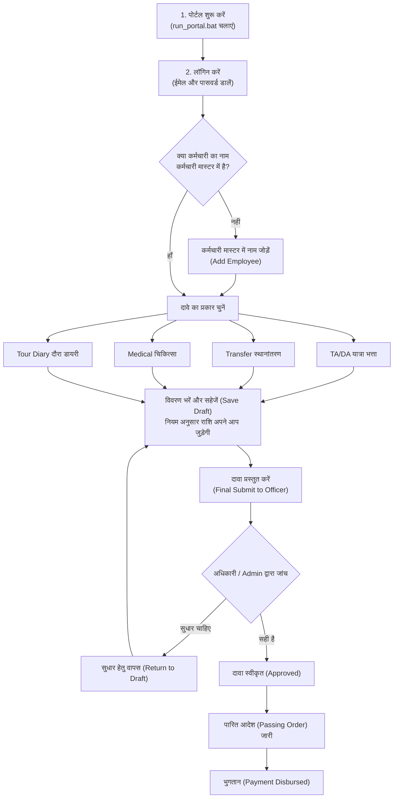
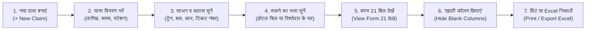

# MPSCSC दावा पोर्टल — आसान द्विभाषी उपयोगकर्ता गाइड
# MPSCSC Claims Portal — Easy Bilingual User Guide

---

> **संस्था / Organisation:** म.प्र. राज्य नागरिक आपूर्ति निगम (MPSCSC Ltd.)  
> **प्रणाली / System:** यात्रा, स्थानांतरण, चिकित्सा दावा एवं दौरा डायरी पोर्टल  
> **भाषा / Language:** सरल हिन्दी + Simple English (आसान बोलचाल की भाषा)  
> **उपयोगकर्ता / Users:** सभी कर्मचारी, शाखा प्रभारी, जिला प्रबंधक, लेखा अधिकारी एवं व्यवस्थापक (Admin)

---

## विषय-सूची / Table of Contents

1. [पोर्टल क्या है और कैसे काम करता है? (System Overview)](#1-पोर्टल-क्या-है-और-कैसे-काम-करता-है-system-overview)
2. [प्रक्रिया फ्लोचार्ट — एक नज़र में (Workflow Flowcharts)](#2-प्रक्रिया-फ्लोचार्ट--एक-नज़र-में-workflow-flowcharts)
3. [मॉड्यूल 1: पोर्टल चालू करना, लॉगिन और पासवर्ड (Login & Password)](#3-मॉड्यूल-1-पोर्टल-चालू-करना-लॉगिन-और-पासवर्ड-login--password)
4. [मॉड्यूल 2: मुख्य डैशबोर्ड (Dashboard)](#4-मॉड्यूल-2-मुख्य-डैशबोर्ड-dashboard)
5. [मॉड्यूल 3: कर्मचारी मास्टर — सबसे पहला और जरूरी काम (Employee Master)](#5-मॉड्यूल-3-कर्मचारी-मास्टर--सबसे-पहला-और-जरूरी-काम-employee-master)
6. [मॉड्यूल 4: यात्रा भत्ता दावा और प्रपत्र 21 बिल (TA/DA Claims & Form 21 Bill)](#6-मॉड्यूल-4-यात्रा-भत्ता-दावा-और-प्रपत्र-21-बिल-tada-claims--form-21-bill)
7. [मॉड्यूल 5: शासकीय दौरा डायरी (Tour Diary)](#7-मॉड्यूल-5-शासकीय-दौरा-डायरी-tour-diary)
8. [मॉड्यूल 6: स्थानांतरण दावा (Transfer Claim)](#8-मॉड्यूल-6-स्थानांतरण-दावा-transfer-claim)
9. [मॉड्यूल 7: चिकित्सा प्रतिपूर्ति दावा (Medical Claim)](#9-मॉड्यूल-7-चिकित्सा-प्रतिपूर्ति-दावा-medical-claim)
10. [मॉड्यूल 8: सभी दावे और एक्सेल रिपोर्ट (Claims Register & Reports)](#10-मॉड्यूल-8-सभी-दावे-और-एक्सेल-रिपोर्ट-claims-register--reports)
11. [मॉड्यूल 9: अधिकारी / व्यवस्थापक के कार्य (Admin Features)](#11-मॉड्यूल-9-अधिकारी--व्यवस्थापक-के-कार्य-admin-features)
12. [मॉड्यूल 10: बैकअप और अक्सर पूछे जाने वाले सवाल (FAQ & Troubleshooting)](#12-मॉड्यूल-10-बैकअप-और-अक्सर-पूछे-जाने-वाले-सवाल-faq--troubleshooting)

---

## 1. पोर्टल क्या है और कैसे काम करता है? (System Overview)

### सरल हिन्दी में:
यह पोर्टल मध्यप्रदेश राज्य नागरिक आपूर्ति निगम (MPSCSC) के अधिकारियों और कर्मचारियों के दावों को ऑनलाइन तैयार करने, नियम अनुसार जांचने और प्रिंट करने के लिए बनाया गया है।
इसके जरिए आप:
- **यात्रा भत्ता (TA/DA Claim):** दौरे की यात्रा, टिकट, होटल या रुकने का खर्चा और दैनिक भत्ता जोड़कर सरकारी **प्रपत्र 21 (Form 21 Bill)** तुरंत बना सकते हैं।
- **स्थानांतरण दावा (Transfer Claim):** ट्रांसफर होने पर सामान ढुलाई, पैकिंग और परिवार की यात्रा का बिल बना सकते हैं।
- **चिकित्सा दावा (Medical Claim):** स्वयं या परिवार के इलाज, दवाइयों और जांच (Lab Test) के बिल का हिंदी फॉर्म भर सकते हैं।
- **दौरा डायरी (Tour Diary):** दौरे के दौरान किए गए शासकीय कार्यों का दिनवार विवरण लिख सकते हैं।
- **ऑफ़लाइन सुविधा:** यह पोर्टल बिना इंटरनेट के भी आपके कंप्यूटर या ऑफिस के लोकल नेटवर्क पर बहुत तेजी से काम करता है।

### In Simple English:
The **MPSCSC Claims Portal** is an easy offline web portal for all staff to create, calculate, and print official claims. It automatically applies the revised MP Government rules (April 2025) for Travelling Allowance, Transfers, and Medical reimbursements without requiring any internet connection.

---

## 2. प्रक्रिया फ्लोचार्ट — एक नज़र में (Workflow Flowcharts)

### A. दावा तैयार करने से भुगतान तक की प्रक्रिया (End-to-End Process)

---

### B. यात्रा भत्ता (TA/DA) और प्रपत्र 21 बिल कैसे बनता है?

---

## 3. मॉड्यूल 1: पोर्टल चालू करना, लॉगिन और पासवर्ड (Login & Password)

### 3.1 पोर्टल कैसे चालू करें? (How to Start)
1. अपने कंप्यूटर पर पोर्टल के मुख्य फ़ोल्डर में जाएं।
2. फ़ाइल **`run_portal.bat`** पर माउस से दो बार क्लिक (Double Click) करें।
3. एक काली स्क्रीन (Command Prompt) खुलेगी। इसे बंद न करें, इसे खुला रहने दें।
4. अपने इंटरनेट ब्राउज़र (Chrome या Edge) में **`http://localhost:5173/`** खोलें। पोर्टल की स्क्रीन सामने आ जाएगी।

---

### 3.2 लॉगिन कैसे करें? (How to Login)
1. स्क्रीन पर अपना **Email Address (ईमेल)** और **Password (पासवर्ड)** दर्ज करें।
2. **"Sign In" (लॉगिन)** बटन पर क्लिक करें। आप सीधे मुख्य डैशबोर्ड पर पहुँच जाएंगे।

> [!TIP]
> **नया खाता बनाना (New Registration):**
> यदि आपका खाता पहले से नहीं बना है, तो लॉगिन स्क्रीन पर नीचे **"Register here"** पर क्लिक करें। अपना नाम, ईमेल, मोबाइल नंबर और पासवर्ड डालकर **"Create Account"** दबाएं। खाता तुरंत चालू हो जाएगा।

---

### 3.3 पासवर्ड भूल जाएं तो क्या करें? (Forgot Password)
* **तरीका 1 (स्वयं रीसेट करें):**
  1. लॉगिन पेज पर **"Forgot Password?" (पासवर्ड भूल गए?)** पर क्लिक करें।
  2. अपना पंजीकृत ईमेल लिखें और बटन दबाएं।
  3. स्क्रीन पर एक लिंक दिखाई देगा, उस पर क्लिक करके नया पासवर्ड दर्ज करें और सहेज लें।
* **तरीका 2 (एडमिन की मदद से):**
  - यदि आप अपना पासवर्ड रीसेट नहीं कर पा रहे हैं, तो अपने कार्यालय के एडमिन (व्यवस्थापक) से संपर्क करें। एडमिन अपने लॉगिन से 1 मिनट में आपका नया पासवर्ड सेट कर सकते हैं।

---

### 3.4 15 मिनट की सुरक्षा — अपने आप लॉगआउट (Inactivity Timeout)
* **यह क्यों होता है?** यदि आप कंप्यूटर छोड़कर चले जाएं, तो कोई अन्य व्यक्ति आपके बिल में बदलाव न कर सके, इसलिए 15 मिनट तक कोई हलचल न होने पर पोर्टल अपने आप सुरक्षित रूप से लॉगआउट हो जाता है।
* **चेतावनी विंडो (14 मिनट पर):** 14 मिनट बाद स्क्रीन पर एक पॉप-अप आएगा जिसमें 60 सेकंड का उल्टी गिनती वाला टाइमर (Countdown) चलेगा।
* **काम जारी रखने के लिए:** बस **"Stay Logged In" (लॉगिन रहें)** बटन पर क्लिक कर दें। आपका काम चालू रहेगा।

---

### 3.5 भाषा कैसे बदलें? (Hindi / English Toggle)
* बाईं तरफ के मेनू (Sidebar) में सबसे नीचे **"हिं"** और **"Eng"** का बटन दिया गया है।
* **"हिं"** दबाने पर पूरी स्क्रीन सरल हिंदी में बदल जाएगी।
* **"Eng"** दबाने पर स्क्रीन अंग्रेजी में हो जाएगी।
* *विशेष बात:* भाषा बदलने पर आपके द्वारा भरा जा रहा डेटा कभी मिटता नहीं है।

---

## 4. मॉड्यूल 2: मुख्य डैशबोर्ड (Dashboard)

डैशबोर्ड आपके पोर्टल का मुख्य पन्ना है। लॉगिन करते ही यह खुलता है:

1. **ऊपर के मुख्य आंकड़े (KPI Cards):**
   - कुल पंजीकृत कर्मचारी कितने हैं।
   - अब तक कुल कितने रुपये के दावे प्रस्तुत हुए।
   - कितनी राशि स्वीकृत होकर भुगतान हो चुकी है।
   - कितने दावों पर अभी निर्णय होना बाकी है।
2. **कार्रवाई योग्य दावे (Decision Queue):**
   - वे दावे जो अभी ड्राफ्ट में पड़े हैं और जिन्हें आपको सबमिट करना है।
   - वे दावे जो जांच हेतु लंबित हैं।
3. **दावा प्रकार चार्ट (Type Distribution):**
   - एक रंगीन वृत्त चार्ट, जो दिखाता है कि यात्रा भत्ता (TA/DA), ट्रांसफर और मेडिकल में से किसमें कितना खर्च हुआ।
4. **त्वरित टाइल्स (Quick Links):**
   - 1 क्लिक में कर्मचारी मास्टर, यात्रा भत्ता, स्थानांतरण या मेडिकल पन्ने पर जाने के शॉर्टकट बटन।

---

## 5. मॉड्यूल 3: कर्मचारी मास्टर — सबसे पहला और जरूरी काम (Employee Master)

> [!IMPORTANT]
> **सबसे जरूरी नियम:**
> किसी भी कर्मचारी का बिल बनाने से पहले उसका नाम **कर्मचारी मास्टर (Employee Master)** में दर्ज होना अनिवार्य है। यदि नाम नहीं जुड़ा होगा, तो आप नया दावा नहीं बना पाएंगे।

---

### 5.1 नया कर्मचारी कैसे जोड़ें? (Step-by-Step)
1. बाईं तरफ के मेनू से **"कर्मचारी मास्टर" (Employee Master)** पर क्लिक करें।
2. ऊपर दाईं ओर हरे रंग के **"+ Add Employee" (+ कर्मचारी जोड़ें)** बटन पर क्लिक करें।
3. नीचे दिए अनुसार आसान जानकारी भरें:
   - **नाम (अंग्रेजी में):** जैसे `Rajesh Sharma`
   - **नाम (हिन्दी में):** जैसे `राजेश शर्मा`
   - **पदनाम (Designation):** जैसे *सहायक लेखा अधिकारी*, *गुणवत्ता निरीक्षक*, *जिला प्रबंधक*, *सहायक ग्रेड-3*
   - **पदस्थ मुख्यालय (Headquarters):** जैसे *भोपाल*, *इंदौर*, *उज्जैन*, *जबलपुर*
   - **वेतन स्तर (Pay Level):** 7वें वेतनमान का लेवल (जैसे *Level 7*, *Level 10*, *Level 12*)
   - **मूल वेतन (Basic Pay):** वर्तमान बेसिक पे (जैसे ₹56,100)
4. **कर्मचारी की श्रेणी (Category A से E) चुनें:**
   - **श्रेणी A (क):** वरिष्ठ अधिकारी, जिला प्रबंधक (मूल वेतन ₹10,000+ पुराना / लेवल 14+)। *पात्रता: हवाई यात्रा, रेल AC 1st क्लास।*
   - **श्रेणी B (ख):** लेवल 10 से 13 के अधिकारी। *पात्रता: रेल AC 2-Tier, AC बस।*
   - **श्रेणी C (ग):** लेवल 7 से 9 के कर्मचारी (सहायक लेखा अधिकारी, आदि)। *पात्रता: रेल AC 3-Tier, डीलक्स बस।*
   - **श्रेणी D (घ):** लेवल 4 से 6 के कर्मचारी (सहायक, लिपिक वर्ग)। *पात्रता: स्लीपर क्लास, एक्सप्रेस बस।*
   - **श्रेणी E (ड़):** लेवल 1 से 3 के कर्मचारी (भृत्य, वाहन चालक आदि)। *पात्रता: साधारण श्रेणी, द्वितीय श्रेणी।*
5. **"Save Employee" (सहेजें)** पर क्लिक करें। कर्मचारी का खाता जुड़ जाएगा।

---

### 5.2 परिवार के सदस्यों का नाम जोड़ना (Family Details for Transfer)
यदि कर्मचारी का ट्रांसफर हुआ है, तो उनके परिवार के सदस्यों के टिकट का पैसा भी मिलता है:
1. कर्मचारी के कार्ड पर **"Manage Family" (परिवार विवरण)** पर क्लिक करें।
2. **"+ Add Member"** पर क्लिक करें।
3. सदस्य का **नाम**, **कर्मचारी से रिश्ता** (पत्नी, पुत्र, पुत्री, माता, पिता) और **जन्म तिथि** भरें।
4. सहेज लें। यह जानकारी ट्रांसफर बिल में अपने आप आ जाएगी।

---

## 6. मॉड्यूल 4: यात्रा भत्ता दावा और प्रपत्र 21 बिल (TA/DA Claims & Form 21 Bill)

यह पोर्टल का सबसे ज्यादा इस्तेमाल होने वाला मॉड्यूल है।

---

### चरण 1: नया दावा शुरू करना (New TA/DA Claim)
1. बाईं तरफ मेनू में **"टीए/डीए दावा" (TA/DA Claim)** पर जाएं।
2. **"+ New TA/DA Claim" (+ नया टीए/डीए दावा)** बटन दबाएं।
3. सूची में से **कर्मचारी का नाम** चुनें।
4. दौरे का **माह (Month)** और **वर्ष (Year)** चुनें (उदा. मार्च 2026)।
5. **"Create Claim"** दबाएं। सिस्टम एक नया दावा नंबर (जैसे `CL-26-0045`) बना देगा।

---

### चरण 2: यात्रा का विवरण दर्ज करना (Journey Details)
दौरे में जहाँ-जहाँ गए, उसका एक-एक फेरा (Journey Leg) दर्ज करें:
1. **प्रस्थान (कहाँ से चले):**
   - तारीख (Date) और समय (Time)।
   - प्रस्थान स्टेशन (Departure Station: जैसे *भोपाल*)।
2. **आगमन (कहाँ पहुँचे):**
   - तारीख (Date) और समय (Time)।
   - आगमन स्टेशन (Arrival Station: जैसे *इंदौर*, *दिल्ली*, *जबलपुर*)।
   - *शहर की श्रेणी सिस्टम अपने आप पहचानता है:*
     - **महानगर (Metro):** दिल्ली, मुंबई, कोलकाता, चेन्नई, बेंगलुरु, हैदराबाद, अहमदाबाद, पुणे, कानपुर।
     - **प्रमुख नगर (Major City):** भोपाल, इंदौर, जबलपुर, ग्वालियर एवं म.प्र. के बाहर के सभी शहर।
     - **अन्य (Other):** म.प्र. के शेष सभी साधारण स्थान।
3. **यात्रा का साधन व क्लास (Mode & Class):**
   - साधन चुनें (Rail, Bus, Air, Own Car, Own Bike)।
   - **क्लास ड्रॉपडाउन अपने आप बदलेगा:**
     - यदि **Rail** चुना: AC 1st, AC 2-Tier, AC 3-Tier, Sleeper आदि।
     - यदि **Bus** चुना: Ordinary, Express, Deluxe, AC बस।
     - यदि **Car / Bike** चुना: सड़क मील भत्ता (कार ₹9/किमी, बाइक ₹4/किमी)।
   - इसमें कर्मचारी की श्रेणी अनुसार **"Entitled" (पात्रता)** का हरा निशान भी दिखेगा।
4. **टिकट और किराया:**
   - टिकट या PNR नंबर लिखें।
   - वास्तविक भुगतान किया गया किराया (₹) भरें।
5. **शासकीय प्रयोजन (Purpose):**
   - यात्रा का कारण लिखें (जैसे: *उपार्जन समीक्षा बैठक*, *गोदाम भौतिक सत्यापन*)।
6. वापसी यात्रा जोड़ने के लिए नीचे **"+ Add Another Leg" (+ अगला फेरा जोड़ें)** दबाएं।

---

### चरण 3: रुकने का खर्चा एवं अग्रिम समायोजन (Stay & Advance)
* **रुकने का प्रकार (Stay Allowance):**
  - **कोई नहीं (None):** उसी दिन वापस आ गए या सरकारी गेस्ट हाउस में रुके।
  - **होटल का बिल (Hotel Bill):** होटल की रसीद की वास्तविक राशि भरें। सरकारी नियम अनुसार अधिकतम सीमा (जैसे महानगर में कैट C को ₹3,700/दिन तक) अपने आप लागू हो जाएगी।
  - **मित्र या रिश्तेदार के घर रुकना (Friends/Relatives Stay):** बिना किसी होटल बिल के सरकार द्वारा निर्धारित फिक्स दैनिक भत्ता (कैट A: ₹750, कैट B: ₹660, कैट C: ₹550, कैट D: ₹450, कैट E: ₹370 प्रतिदिन)।
* **दौरा अग्रिम कटौती (TA Advance):**
  - यदि दौरे पर जाने से पहले ऑफिस से कोई अग्रिम राशि ली थी, तो उसे **"Advance Drawn (अग्रिम राशि)"** में भरें। यह राशि कुल देयक में से अपने आप घट जाएगी।
* **"Save Journey Details"** दबाकर सहेजें।

---

### चरण 4: प्रपत्र 21 बिल देखना और प्रिंट करना (Form 21 Bill)

ऊपर दिए बटन **"View Bill" (देयक देखें)** पर क्लिक करें। आपके सामने मध्यप्रदेश शासन का आधिकारिक **प्रपत्र २१ (Form 21 TA Bill)** खुल जाएगा।

#### प्रपत्र 21 की खास सुविधाएं:

> [!TIP]
> **जादुई बटन: "रिक्त कॉलम छिपाएं" (Hide Blank Columns)**
> सरकारी प्रपत्र 21 में कुल 21 कॉलम होते हैं। साधारण दौरे में कई कॉलम (जैसे ट्रांसफर अनुदान, सामान परिवहन, आदि) खाली रह जाते हैं।
> - बिल के ऊपर **"Hide Blank Columns" (रिक्त कॉलम छिपाएं)** बटन पर क्लिक करें।
> - सभी खाली कॉलम 1 सेकंड में गायब हो जाएंगे!
> - बचे हुए कॉलमों के नंबर अपने आप क्रम से **1, 2, 3, 4...** हो जाएंगे।
> - बिल पूरे पन्ने पर खूबसूरत और चौड़ा फैल जाएगा, कोई खाली जगह नहीं छूटेगी।

* **पारित आदेश (Passing Order) की गोपनीयता:**
  - जब कोई कर्मचारी अपने लॉगिन से बिल देखता है, तो बिल कर्मचारी के हस्ताक्षर पर ही समाप्त हो जाता है।
  - भाग 4 **"देयक पारित आदेश"** केवल अधिकारी (Admin) के लॉगिन में दिखता है, ताकि बिना अनुमोदन कोई पारित आदेश प्रिंट न कर सके।
* **प्रिंट विकल्प:**
  - **Print: A4 Landscape (आड़ा पन्ना - सबसे बढ़िया):** पूरे 21 कॉलम एक ही पन्ने पर साफ-साफ आ जाते हैं।
  - **Print: A4 Portrait (खड़ा पन्ना):** सामान्य पन्ने पर प्रिंट करने के लिए।
  - **Export to Excel:** पूरे बिल की एक्सेल फ़ाइल डाउनलोड करने के लिए।

---

## 7. मॉड्यूल 5: शासकीय दौरा डायरी (Tour Diary)

शासकीय नियमों के अनुसार यात्रा भत्ते के साथ दौरे पर किए गए कार्यों की **दौरा डायरी** लगाना अनिवार्य होता है।

### दौरा डायरी कैसे भरें?
1. बाईं तरफ मेनू में **"दौरा डायरी" (Tour Diary)** पर जाएं।
2. नया दौरा डायरी बनाएं या TA/DA दावे के अंदर से सीधे **"Tour Diary"** पर क्लिक करें।
3. दौरे की प्रत्येक तारीख के सामने लिखें कि उस दिन आपने क्या शासकीय कार्य किया (जैसे: *सोसायटी क्र. 102 में धान खरीदी का निरीक्षण किया एवं वजन तौल की जांच की*)।
4. **दैनिक भत्ता (DA) का सरकारी नियम (सिस्टम अपने आप निकालता है):**
   - **यात्रा अवधि 6 घंटे या कम:** 0% DA (दैनिक भत्ता नहीं मिलेगा)।
   - **यात्रा अवधि 6 से 12 घंटे:** 50% DA (आधा दैनिक भत्ता)।
   - **यात्रा अवधि 12 घंटे से अधिक:** 100% DA (पूरा दैनिक भत्ता)।

---

## 8. मॉड्यूल 6: स्थानांतरण दावा (Transfer Claim)

जब किसी कर्मचारी का एक जिले से दूसरे जिले में ट्रांसफर होता है, तब यह दावा भरा जाता है।

### स्थानांतरण दावा भरने के आसान चरण:
1. मेनू में **"स्थानांतरण दावा" (Transfer Claim)** पर जाएं और **"+ New Transfer Claim"** दबाएं।
2. स्थानांतरित कर्मचारी का चयन करें।
3. **पुराना मुख्यालय** और **नवीन मुख्यालय** चुनें (म.प्र. के 52 जिलों की सूची में से)।
4. **परिवार के सदस्य:** उन सदस्यों के आगे सही (✓) का निशान लगाएं जो कर्मचारी के साथ गए हैं।
5. **सामान का वजन (Baggage Weight):**
   - कुल सामान का वजन किग्रा में लिखें।
   - *अधिकतम सीमा:* कैट A और B (6,000 किग्रा), कैट C (3,000 किग्रा), कैट D (1,500 किग्रा), कैट E (1,000 किग्रा)।
6. **ट्रक भाड़ा (Goods Transport):** सामान लाने वाले ट्रक/ट्रांसपोर्ट का बिल भरें (कैट A/B: ₹40/किमी, कैट C/D: ₹25/किमी तक)।
7. **पैकिंग एवं लोडिंग खर्चा:** सामान पैक करने और चढ़ाने-उतारने की रसीद की राशि भरें।
8. **मुश्त स्थानांतरण अनुदान (Transfer Grant):** कर्मचारी की श्रेणी अनुसार एकमुश्त अनुदान (कैट A: ₹6,500, कैट B: ₹5,000, कैट C: ₹3,600, कैट D: ₹2,500, कैट E: ₹1,800) अपने आप जुड़ जाएगा।
9. सहेजें और प्रिंट निकालें।

---

## 9. मॉड्यूल 7: चिकित्सा प्रतिपूर्ति दावा (Medical Claim)

कर्मचारी या उनके आश्रित परिवार के सदस्यों के इलाज के खर्च की प्रतिपूर्ति के लिए यह मॉड्यूल है।

### चिकित्सा दावा कैसे भरें?
1. मेनू में **"चिकित्सा प्रतिपूर्ति" (Medical Claim)** पर जाएं और **"+ New Medical Claim"** दबाएं।
2. **रोगी की जानकारी भरें:**
   - मरीज का नाम।
   - कर्मचारी से संबंध (स्वयं, पत्नी, पति, पुत्र, पुत्री, माता, पिता)।
   - बीमारी का नाम (जैसे: *टाइफाइड, वायरल फीवर, हृदय रोग, फ्रैक्चर*)।
   - इलाज की अवधि (किस तारीख से किस तारीख तक)।
   - संलग्न बिलों/रसीदों की कुल संख्या।
3. **एक-एक बिल जोड़ें (+ Add Bill Item):**
   - **प्रकार चुनें:** `CONSULTATION` (डॉक्टर फीस), `MEDICINE` (दवाइयां), `TEST` (खून/पेशाब/एक्स-रे जांच), या `OTHER` (अन्य)।
   - दुकान / डॉक्टर / पैथोलॉजी लैब का नाम लिखें।
   - रसीद नंबर और रसीद की तारीख भरें।
   - बिल की राशि (₹) लिखें।
4. **"Save Medical Claim"** पर क्लिक करें।
5. **प्रिंट निकालें:** **"Print Claim Form"** दबाएं। मध्यप्रदेश सिविल सेवा चिकित्सा नियमों के अनुसार भरा हुआ पूरा हिंदी आवेदन पत्र तैयार हो जाएगा, जिस पर नीचे हस्ताक्षर करके कार्यालय में जमा किया जा सकता है।

---

## 10. मॉड्यूल 8: सभी दावे और एक्सेल रिपोर्ट (Claims Register & Reports)

### 10.1 सभी दावों की सूची (All Claims Register - `/claims`)
* इस पन्ने पर आपको आपके द्वारा बनाए गए सभी दावे एक साथ दिखते हैं।
* ऊपर दिए गए टैब से आप छांट सकते हैं:
  - **सभी (All)**
  - **ड्राफ्ट (Draft):** जो अभी बन रहे हैं।
  - **प्रस्तुत (Submitted):** जो अधिकारी को भेजे जा चुके हैं।
  - **स्वीकृत (Approved):** जो पास हो चुके हैं।
  - **निरस्त (Rejected):** जो अस्वीकृत हुए।

---

### 10.2 रिपोर्ट और एक्सेल डाउनलोड (Reports - `/reports`)
1. **तारीख चुनें:** शुरुआत की तारीख और अंतिम तारीख (जैसे *01/04/2025 से 31/03/2026* पूरे वित्तीय वर्ष हेतु)।
2. **कर्मचारी चुनें:** किसी एक कर्मचारी की रिपोर्ट देखनी हो या पूरे कार्यालय की।
3. **दावे का प्रकार चुनें:** TA/DA, Transfer, या Medical।
4. स्क्रीन पर कुल दावे और कुल पास हुई राशि आ जाएगी।
5. **Excel Export (एक्सेल डाउनलोड):** हरे रंग के **"Export to Excel"** बटन पर क्लिक करें। पूरी रिपोर्ट की सुंदर एक्सेल शीट तुरंत आपके कंप्यूटर पर डाउनलोड हो जाएगी।

---

## 11. मॉड्यूल 9: अधिकारी / व्यवस्थापक के कार्य (Admin Features)

> [!NOTE]
> यह भाग केवल उन अधिकारियों (व्यवस्थापकों) के लिए है जिनके पास **`admin`** अधिकार हैं।

### 11.1 कर्मचारियों के खातों का नियंत्रण (`/admin/users`)
* **खाता चालू या बंद करना:** किसी भी उपयोगकर्ता का खाता `active` (चालू) या `suspended` (निलंबित) किया जा सकता है।
* **पासवर्ड बदलना (Admin Password Override):** यदि कोई कर्मचारी पासवर्ड भूल जाए और खुद न बदल पाए, तो एडमिन उनके प्रोफाइल में जाकर नया पासवर्ड लिखकर तुरंत सेट कर सकते हैं।
* **उपयोगकर्ता के रूप में लॉगिन करें (Log In As This User):**
  - यदि किसी कर्मचारी को बिल भरने में कोई दिक्कत आ रही हो, तो एडमिन बिना पासवर्ड पूछे 1 क्लिक में उस कर्मचारी की स्क्रीन में जा सकते हैं।
  - स्क्रीन के ऊपर एक पीले रंग की पट्टी (Banner) दिखेगी।
  - कर्मचारी की समस्या देखने या सुधारने के बाद, ऊपर दिए **"Exit & Return to Admin" (व्यवस्थापक पर वापस जाएं)** बटन को दबाते ही आप सुरक्षित वापस एडमिन में आ जाएंगे।

---

### 11.2 राज्यव्यापी दावों की स्वीकृति (`/admin/claims`)
1. अधिकारी के पास जिले या राज्य के सभी कर्मचारियों के दावे इस सूची में आते हैं।
2. दावे का परीक्षण करने के बाद अधिकारी के पास 3 विकल्प होते हैं:
   - **स्वीकृत करें (Approve):** दावा सही होने पर इसे पास करें।
   - **सुधार हेतु वापस करें (Return):** यदि टिकट नंबर या रसीद छूट गई हो, तो रिमार्क लिखकर दावे को ड्राफ्ट में लौटा दें ताकि कर्मचारी सुधार सके।
   - **निरस्त करें (Reject):** यदि दावा नियमानुसार न हो, तो कारण लिखकर निरस्त करें।
3. **देयक पारित आदेश जारी करना:** प्रपत्र 21 के भाग 4 में पारित राशि लिखकर हस्ताक्षर करें।

---

## 12. मॉड्यूल 10: बैकअप और अक्सर पूछे जाने वाले सवाल (FAQ & Troubleshooting)

### 12.1 डेटा सुरक्षित रखने के टूल्स (Backup)

| फ़ाइल का नाम | इसका क्या काम है? | कैसे चलाएं? |
|---|---|---|
| `run_portal.bat` | पोर्टल चालू करने के लिए | माउस से डबल क्लिक करें |
| `backup_database.bat` | पूरे डेटा का सुरक्षित बैकअप ZIP बनाने के लिए | सप्ताह में एक बार डबल क्लिक करें |
| `install_dependencies.bat` | नए कंप्यूटर में पोर्टल सेटअप करने के लिए | केवल पहली बार चलाएं |

---

### 12.2 सामान्य प्रश्न एवं उनके आसान उत्तर (FAQ)

#### प्र. 1: भाषा कैसे बदलें (हिंदी से अंग्रेजी या अंग्रेजी से हिंदी)?
**उत्तर:** बाईं तरफ सबसे नीचे मेनू में **"हिं"** और **"Eng"** का बटन दिया गया है। अपनी पसंद का बटन दबाएं, भाषा तुरंत बदल जाएगी।

#### प्र. 2: काम करते-करते अचानक पोर्टल लॉगआउट क्यों हो गया?
**उत्तर:** सुरक्षा के लिए यदि आप 15 मिनट तक कंप्यूटर पर कोई कीबोर्ड या माउस नहीं चलाते, तो पोर्टल अपने आप बंद हो जाता है। 14 मिनट पर एक उल्टी गिनती वाली खिड़की आती है, उसमें बस **"Stay Logged In"** दबा दिया करें।

#### प्र. 3: प्रपत्र 21 में बहुत सारे खाली कॉलम आ रहे हैं, उन्हें कैसे हटाएं?
**उत्तर:** बिल के ऊपर दिए गए **"Hide Blank Columns" (रिक्त कॉलम छिपाएं)** बटन को दबाएं। सारे खाली कॉलम हट जाएंगे और पन्ना बहुत साफ और सुंदर दिखेगा।

#### प्र. 4: मेरे बिल पर "देयक पारित आदेश" (Passing Order) क्यों नहीं दिख रहा?
**उत्तर:** नियम अनुसार पारित आदेश केवल सक्षम अधिकारी (Admin) के लॉगिन में दिखता है। सामान्य कर्मचारी के बिल पर केवल कर्मचारी के हस्ताक्षर आते हैं।

#### प्र. 5: क्या मैं अपने बिल को एक्सेल में डाउनलोड कर सकता हूँ?
**उत्तर:** हाँ, बिल के ऊपर या रिपोर्ट्स के पन्ने पर दिए गए **"Export to Excel"** बटन पर क्लिक करें। एक्सेल फ़ाइल तुरंत डाउनलोड हो जाएगी।

#### प्र. 6: यदि पोर्टल न खुले तो क्या करें?
**उत्तर:** जांचें कि क्या `run_portal.bat` वाली काली स्क्रीन खुली है? यदि बंद हो गई हो, तो `run_portal.bat` पर फिर से डबल क्लिक करें और ब्राउज़र में `http://localhost:5173/` खोलें।

---

*MPSCSC Claims Portal — मध्यप्रदेश राज्य नागरिक आपूर्ति निगम*  
*सरल, पारदर्शी एवं पूर्णतः डिजिटल दावा प्रबंधन प्रणाली © 2026*
