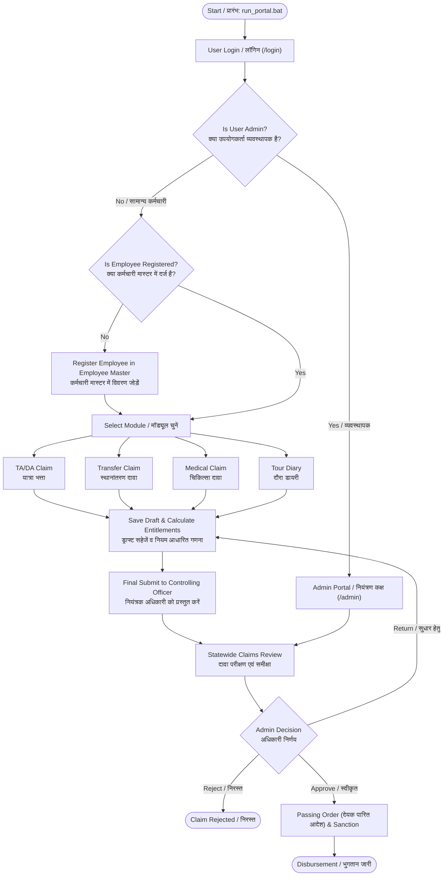
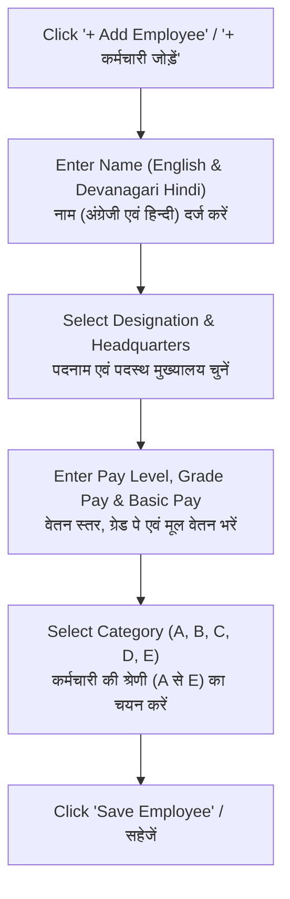
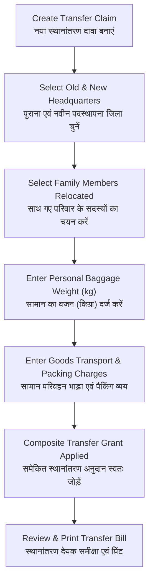

# MPSCSC Claims Portal — Complete Bilingual Help & Operations Guide
# मध्यप्रदेश राज्य नागरिक आपूर्ति निगम (MPSCSC) दावा पोर्टल — संपूर्ण द्विभाषी संचालन एवं उपयोगकर्ता मार्गदर्शिका

---

> **Organisation / संस्था:** Madhya Pradesh State Civil Supplies Corporation Ltd. (MPSCSC)  
> **System / प्रणाली:** Enterprise Claims & Entitlements Portal (TA/DA, Transfer, Medical, Tour Diary)  
> **Target Audience / लक्षित उपयोगकर्ता:** All Officers, District Managers, Accounts Staff, Claimants & System Administrators  
> **Language / भाषा:** Simple Dual Language (English + सरल हिन्दी)  
> **Rules Reference / नियम संदर्भ:** MP Civil Services (Travelling Allowance) Rules, Medical Attendance Rules & Composite Transfer Guidelines (Revised April 2025)

---

## Table of Contents / विषय-सूची

1. [System Overview & Architecture / सिस्टम का संक्षिप्त परिचय](#1-system-overview--architecture)
2. [Visual Process Flowcharts / मुख्य प्रक्रिया फ्लोचार्ट](#2-visual-process-flowcharts)
3. [Module 1: Authentication, Login & Security / मॉड्यूल 1: खाता प्रमाणीकरण, लॉगिन एवं सुरक्षा](#3-module-1-authentication-login--security)
4. [Module 2: Dashboard & Workspace / मॉड्यूल 2: डैशबोर्ड एवं मुख्य कार्यक्षेत्र](#4-module-2-dashboard--workspace)
5. [Module 3: Employee Master & Family Setup / मॉड्यूल 3: कर्मचारी मास्टर एवं परिवार प्रबंधन](#5-module-3-employee-master--family-setup)
6. [Module 4: TA/DA Claims & Statutory Form 21 Bill / मॉड्यूल 4: यात्रा एवं दैनिक भत्ता (TA/DA) तथा प्रपत्र 21 देयक](#6-module-4-tada-claims--statutory-form-21-bill)
7. [Module 5: Official Tour Diary Module / मॉड्यूल 5: शासकीय दौरा डायरी (Tour Diary)](#7-module-5-official-tour-diary-module)
8. [Module 6: Transfer Claims Management / मॉड्यूल 6: स्थानांतरण दावा प्रबंधन (Transfer Claims)](#8-module-6-transfer-claims-management)
9. [Module 7: Medical Reimbursement Claims / मॉड्यूल 7: चिकित्सा प्रतिपूर्ति दावा (Medical Claims)](#9-module-7-medical-reimbursement-claims)
10. [Module 8: Universal Claims Register & Reports / मॉड्यूल 8: सार्वभौमिक दावा रजिस्टर एवं रिपोर्ट्स](#10-module-8-universal-claims-register--reports)
11. [Module 9: Administrative Portal & Statewide Governance / मॉड्यूल 9: व्यवस्थापक पोर्टल एवं राज्यव्यापी नियंत्रण](#11-module-9-administrative-portal--statewide-governance)
12. [Module 10: System Utilities, Backup & Troubleshooting (FAQ) / मॉड्यूल 10: बैकअप एवं सामान्य प्रश्नोत्तर](#12-module-10-system-utilities-backup--troubleshooting-faq)

---

## 1. System Overview & Architecture / सिस्टम का संक्षिप्त परिचय

### English
The **MPSCSC Claims Portal** is a secure, offline-first web portal built to digitise and automate employee entitlements across the State of Madhya Pradesh. It manages Travelling Allowance/Daily Allowance (TA/DA) under the April 2025 MP Govt revised rates, Employee Relocation/Transfer allowances, Medical Reimbursements, and Official Tour Diaries. It operates on your local network/PC without any mandatory internet dependency.

### हिन्दी (Hindi)
**म.प्र. राज्य नागरिक आपूर्ति निगम (MPSCSC) दावा पोर्टल** एक सुरक्षित और ऑफलाइन-सक्षम वेब एप्लीकेशन है। इसे मध्यप्रदेश शासन के अप्रैल 2025 के नवीनतम पुनरीक्षित नियमों के अनुसार कर्मचारियों के यात्रा भत्ता/दैनिक भत्ता (TA/DA), स्थानांतरण भत्ता (Transfer Claim), चिकित्सा व्यय प्रतिपूर्ति (Medical Claim) तथा शासकीय दौरा डायरी (Tour Diary) के डिजिटलीकरण और त्वरित निपटान हेतु तैयार किया गया है। यह बिना इंटरनेट के भी लोकल कंप्यूटर अथवा कार्यालय के लोकल नेटवर्क (LAN) पर सुचारू रूप से कार्य करता है।

### User Roles / उपयोगकर्ता भूमिकाएं:
1. **Individual Claimant / User (सामान्य कर्मचारी/दावेदार):**
   - Can register, maintain their employee profile & family members.
   - Can prepare drafts, enter journeys, medical bills, and generate bills.
   - Can submit claims for official scrutiny and download Form 21 bills / Excel exports.
2. **Administrator / Controlling Officer (व्यवस्थापक/नियंत्रक अधिकारी):**
   - Comprehensive oversight across all districts and employees statewide.
   - Ability to Approve (`APPROVED`), Reject (`REJECTED`), or Return claims for corrections.
   - Authorised to view and sign Section 4: Controlling Officer Certificate & Passing Order ("देयक पारित आदेश").
   - User account activation, administrative password overrides, and temporary user impersonation.

---

## 2. Visual Process Flowcharts / मुख्य प्रक्रिया फ्लोचार्ट

### A. Overall Portal Workflow / संपूर्ण पोर्टल कार्यप्रवाह



---

### B. TA/DA & Form 21 Statutory Bill Workflow / यात्रा भत्ता एवं प्रपत्र 21 बिल निर्माण

```mermaid
flowchart LR
    Step1["1. New TA/DA Claim<br/>नया दावा (CL-YY-XXXX)"] --> Step2["2. Add Journey Legs<br/>यात्रा विवरण भरें"]
    Step2 --> Step3["3. Dynamic Travel Class<br/>पात्र श्रेणी व टिकट विवरण"]
    Step3 --> Step4["4. Stay Allowance<br/>ठहराव भत्ता (होटल/रिश्तेदार)"]
    Step4 --> Step5["5. Auto Engine<br/>स्वचालित गणना (DA Slabs)"]
    Step5 --> Step6["6. Form 21 Bill<br/>प्रपत्र 21 देयक तैयार"]
    Step6 --> Step7["7. Hide Blank Columns<br/>रिक्त कॉलम छुपाएं (1..N)"]
    Step7 --> Step8["8. Print / Excel Export<br/>प्रिंट अथवा एक्सेल निर्यात"]
```



---

## 3. Module 1: Authentication, Login & Security / मॉड्यूल 1: खाता प्रमाणीकरण, लॉगिन एवं सुरक्षा

### 3.1 Starting the System / सिस्टम चालू करना
* **English:** Double click the file `run_portal.bat` located in the application root directory. This starts the Express Server (Port 5000) and launches the Vite React frontend (Port 5173). Open your browser at `http://localhost:5173/`.
* **हिन्दी:** मुख्य फ़ोल्डर में मौजूद `run_portal.bat` फ़ाइल पर डबल-क्लिक करें। इससे बैकएंड सर्वर (Port 5000) और यूज़र इंटरफ़ेस (Port 5173) दोनों शुरू हो जाएंगे। ब्राउज़र में `http://localhost:5173/` खोलें।

---

### 3.2 User Login & Registration / उपयोगकर्ता लॉगिन एवं नवीन पंजीयन

#### Step-by-Step Login / लॉगिन के चरण:
1. **Navigate to /login**: Enter your registered **Email Address** and **Password**.
   - *हिन्दी:* लॉगिन स्क्रीन पर अपना पंजीकृत **ईमेल आईडी** और **पासवर्ड** दर्ज करें।
2. **Click "Sign In" (साइन इन करें):** Upon successful verification, you will be redirected to the Dashboard (or Admin Dashboard for administrators).
   - *हिन्दी:* "साइन इन" बटन दबाएं। सत्यापन के पश्चात आप सीधे मुख्य डैशबोर्ड पर पहुँच जाएंगे।
3. **New User Registration (नया खाता बनाएं):**
   - Click **"Register here"** on the login page.
   - Fill in: **Full Name** (पूरा नाम), **Email Address** (ईमेल आईडी), **Mobile Number** (मोबाइल नंबर), and **Password** (पासवर्ड - न्यूनतम 6 अक्षर).
   - Click **"Create Account" (खाता बनाएं)**. Your account is immediately activated in `active` status.

---

### 3.3 Password Recovery & Reset / पासवर्ड भूल जाने पर रीसेट करना

#### Option A: Self-Service Reset (उपयोगकर्ता द्वारा स्वयं रीसेट):
1. Click **"Forgot Password?" (पासवर्ड भूल गए?)** on the login screen.
2. Enter your registered email address and click **"Generate Reset Link"**.
3. A secure 15-minute token is generated. On local setups, the direct reset link is shown on screen for instant access.
4. Click the link to open `/reset-password?token=...`, type your **New Password** (नया पासवर्ड), re-enter to confirm, and submit.

#### Option B: Administrative Password Override (प्रशासक द्वारा पासवर्ड बदलना):
* If an employee forgets their password and cannot recover it, an Administrator can navigate to `/admin/users/:id`, enter a new temporary password in the **"Administrative Password Override"** box, and click **"Apply New Password"**. The user can then immediately log in with that password.

---

### 3.4 Enterprise Inactivity Security / 15 मिनट की निष्क्रियता पर सुरक्षा लॉगआउट
* **Warning Modal (14 मिनट बाद चेतावनी):** If the portal remains idle with no mouse or keyboard activity for 14 minutes, a security dialog appears warning: *"Session Expiring Soon"* with a **60-second live countdown timer**.
* **Options:** Click **"Stay Logged In" (लॉगिन रहें)** to continue working, or **"Log Out Now" (अभी लॉगआउट करें)** to exit immediately.
* **Auto-Logout (15 मिनट पर स्वतः लॉगआउट):** If no response is received, the session automatically terminates to protect sensitive financial records from unattended desktop access.

---

### 3.5 Bilingual Language Toggle / भाषा परिवर्तन (हिन्दी / English)
* In the left sidebar navigation (bottom panel), click the **"हिं"** button to switch the entire application interface to Hindi, or **"Eng"** to switch to English.
* Form data currently being entered is **never lost** when toggling languages.

---

## 4. Module 2: Dashboard & Workspace / मॉड्यूल 2: डैशबोर्ड एवं मुख्य कार्यक्षेत्र

**Route / मार्ग:** `/` | **Component:** `Dashboard.jsx`

```
┌─────────────────────────────────────────────────────────────────────────────┐
│ 📊 MPSCSC CLAIMS OVERVIEW — DASHBOARD / मुख्य डैशबोर्ड                      │
├─────────────────────────────────────────────────────────────────────────────┤
│ [ Total Employees: 12 ] [ Total Claimed: ₹84,500 ] [ Disbursed: ₹62,000 ]   │
├──────────────────────────────────────┬──────────────────────────────────────┤
│ ⚡ Decision Queue (कार्रवाई हेतु दावे) │ 🥧 Type Distribution (दावा प्रकार)   │
│ - CL-26-0012 (TA/DA): Needs Submit   │   ■ TA/DA (65%)                      │
│ - MD-26-0004 (Medical): In Review    │   ■ Transfer (20%)   ■ Medical (15%) │
├──────────────────────────────────────┴──────────────────────────────────────┤
│ 📈 6-Month Expenditure Trend (माहवार व्यय प्रवृत्ति)                       │
│ 🗂️ Quick Workspace Tiles: [Employees] [TA/DA] [Transfer] [Medical] [Reports]│
└─────────────────────────────────────────────────────────────────────────────┘
```

### Key Elements / मुख्य विशेषताएं:
1. **Live Metric Cards (प्रमुख वित्तीय संकेतक):** Instant summary of Total Employees registered, Total Amount Claimed, Disbursed Amount, and Claims Pending Decision.
   - *हिन्दी:* पंजीकृत कर्मचारियों की कुल संख्या, कुल दावा राशि, स्वीकृत/भुगतान की गई राशि तथा लंबित दावों की संख्या एक नज़र में दिखती है।
2. **Decision Queue (कार्रवाई योग्य दावे):** Displays high-priority claims requiring your prompt attention (drafts pending submission or claims awaiting managerial review).
   - *हिन्दी:* वे दावे जिन्हें प्रस्तुत (Submit) किया जाना शेष है अथवा जो निर्णय हेतु लंबित हैं।
3. **Quick Workspace Tiles (त्वरित नेविगेशन टाइल्स):** One-click shortcut cards directing you straight into Employee Master, TA/DA, Transfer, Medical, or Reports.

---

## 5. Module 3: Employee Master & Family Setup / मॉड्यूल 3: कर्मचारी मास्टर एवं परिवार प्रबंधन

**Route / मार्ग:** `/employees` | **Access:** All Authenticated Users

> [!IMPORTANT]
> **Mandatory Prerequisite / अनिवार्य पूर्व-शर्त:**
> A claim can only be prepared for a registered employee. You **must** create or select an employee record before creating any TA/DA, Transfer, or Medical claim.
> *हिन्दी: किसी भी यात्रा, स्थानांतरण या चिकित्सा दावे को बनाने से पहले संबंधित कर्मचारी का पंजीयन "कर्मचारी मास्टर" में होना अनिवार्य है।*

---

### 3.1 Step-by-Step: Adding a New Employee / कर्मचारी जोड़ने के चरण



#### Detailed Field Descriptions / विवरण:
* **Full Name (नाम):** Enter the employee's official name in English (e.g., `Rajesh Sharma`) and in Hindi (e.g., `राजेश शर्मा`).
* **Designation (पदनाम):** Official post (e.g., *District Manager*, *Assistant Accounts Officer*, *Quality Inspector*, *Clerk*).
* **Headquarters (मुख्यालय):** Official home station/district (e.g., *Bhopal*, *Indore*, *Jabalpur*, *Ujjain*).
* **Pay Level & Basic Pay (वेतन स्तर व मूल वेतन):** 7th Pay Matrix Level (e.g., *Level 12*) and current Basic Pay (मूल वेतन, उदा. ₹67,300).
* **Employee Category (श्रेणी A से E):** 
  > [!TIP]
  > **Statutory Category Classification (म.प्र. शासन नियम अनुसार श्रेणी):**
  > - **Category A (श्रेणी 'क'):** Basic Pay ₹10,000+ (Old) / Level 14 & above (Senior Executives, DMs). Entitled to **AC 1st Class / Air / Executive Class**.
  > - **Category B (श्रेणी 'ख'):** Basic Pay ₹8,000 to ₹9,999 / Level 10 to 13. Entitled to **AC 2-Tier / AC Bus**.
  > - **Category C (श्रेणी 'ग'):** Basic Pay ₹6,500 to ₹7,999 / Level 7 to 9. Entitled to **AC 3-Tier / Deluxe Bus**.
  > - **Category D (श्रेणी 'घ'):** Basic Pay ₹4,000 to ₹6,499 / Level 4 to 6. Entitled to **Sleeper Class / Express Bus**.
  > - **Category E (श्रेणी 'ड़'):** Basic Pay below ₹4,000 / Level 1 to 3 (Support Staff). Entitled to **Ordinary / 2nd Sitting**.

---

### 3.2 Family Members Sub-Management / परिवार के सदस्यों का विवरण
* To manage family members eligible for **Transfer Claims (स्थानांतरण दावे)**:
  1. Click **"Manage Family" (परिवार विवरण)** on the employee card.
  2. Click **"+ Add Member" (+ सदस्य जोड़ें)**.
  3. Enter **Full Name** (नाम), **Relationship** (संबंध: उदा. पत्नी/पति, पुत्र, पुत्री, माता, पिता), and **Date of Birth** (जन्म तिथि).
  4. Click **"Save Member"**. This data automatically populates transfer entitlement forms.

---

## 6. Module 4: TA/DA Claims & Statutory Form 21 Bill / मॉड्यूल 4: यात्रा एवं दैनिक भत्ता (TA/DA) तथा प्रपत्र 21 देयक

**Routes / मार्ग:**
- `/claims/tada` — TA/DA Claims Directory (दावा सूची)
- `/claims/:id` — Multi-Leg Journey Editor (यात्रा चरण संपादक)
- `/claims/:id/bill` — Statutory Form 21 Bill View & Print (प्रपत्र 21 देयक)

---

### 6.1 Creating a New TA/DA Claim / नया यात्रा भत्ता दावा बनाना
1. Navigate to **TA/DA Claims** (`/claims/tada`) and click **"+ New TA/DA Claim" (+ नया टीए/डीए दावा)**.
2. Select the **Employee** from the dropdown.
3. Choose the **Month** and **Year** of tour (उदा. माह: *March*, वर्ष: *2026*).
4. Click **"Create Claim"**. The system generates a statutory claim identifier (e.g. `CL-26-0045`) and opens the **Claim Editor**.

---

### 6.2 Entering Journey Details (Multi-Leg Editor) / यात्रा विवरण दर्ज करना

For each leg of travel during the tour:
1. **Departure Details (प्रस्थान):**
   - Date (`YYYY-MM-DD`) and Time (`HH:MM`).
   - Departure Station (प्रस्थान स्थान: e.g., *Bhopal*).
2. **Arrival Details (आगमन):**
   - Date (`YYYY-MM-DD`) and Time (`HH:MM`).
   - Arrival Station (गंतव्य स्थान: e.g., *Indore*, *Delhi*, *Jabalpur*).
   > [!NOTE]
   > The system automatically detects the **City Tier**:
   > - **Metro (महानगर):** Delhi, Mumbai, Kolkata, Chennai, Bengaluru, Hyderabad, Ahmedabad, Pune, Kanpur.
   > - **Major MP City (प्रमुख नगर):** Bhopal, Indore, Jabalpur, Gwalior & all stations outside MP.
   > - **Other (साधारण दर):** Other stations within Madhya Pradesh.
3. **Conveyance Mode & Dynamic Travel Class (साधन एवं यात्रा श्रेणी):**
   - Select **Mode of Travel** (Rail, Bus, Air, Own Car, Own Bike, Taxi/Auto).
   - **Dynamic Class Dropdown:** The travel class automatically filters based on the selected mode:
     - **Rail (रेल):** AC 1st Class, AC 2-Tier, AC 3-Tier, AC Chair Car, Sleeper, 2nd Class.
     - **Bus (बस):** Ordinary, Express, Deluxe, AC Sleeper.
     - **Air (हवाई यात्रा):** Economy Class, Business Class.
     - **Personal Vehicle (निजी वाहन):** Own Car (₹9/km), Motor Cycle/Scooter (₹4/km).
   - The dropdown displays an **"Entitled" (पात्र)** badge matching the employee's category.
4. **Ticket & Financials (टिकट एवं किराया):**
   - Enter **Ticket / PNR No.** (टिकट क्रमांक).
   - Enter **Actual Fare Paid** (वास्तविक किराया राशि ₹).
   - Enter **Distance in KM** (if claiming road mileage allowance).
5. **Official Purpose (शासकीय प्रयोजन):**
   - Enter reason for travel (e.g., *Paddy Procurement Review Meeting*, *Warehouse Physical Verification*).
   - Legs sharing the same purpose are automatically grouped into official travel chains.
6. Click **"+ Add Another Leg"** to enter the return or next journey leg.

---

### 6.3 Stay Allowance & Advances / ठहराव भत्ता एवं अग्रिम समायोजन

* **Stay Allowance Type (ठहराव का प्रकार):**
  - **None (कोई नहीं):** Same-day return or accommodation arranged by Corporation/Govt.
  - **Hotel Bill (होटल देयक):** Enter the actual hotel receipt amount paid. The system automatically applies the statutory ceiling per category and city tier (e.g. up to ₹7,400/day for Cat A in Metros; ₹3,700 for Cat C in Metros; ₹1,850 in regular MP cities).
  - **Friends & Relatives Stay (मित्र/रिश्तेदार के यहाँ ठहराव):** Fixed statutory daily allowance without requiring hotel receipts (Cat A: ₹750/day; Cat B: ₹660; Cat C: ₹550; Cat D: ₹450; Cat E: ₹370).
* **TA Advance Adjustment (दौरा अग्रिम राशि):**
  - If any tour advance was received from the office prior to the tour, enter the amount in **"Advance Drawn (अग्रिम राशि)"**. The system will deduct this from the gross total to calculate the net payable amount.
* Click **"Save Journey Details" (यात्रा विवरण सहेजें)**.

---

### 6.4 Statutory Form 21 Bill (प्रपत्र २१) & Print Controls

Click **"View Bill" (देयक देखें)** or navigate to `/claims/:id/bill` to view the official MP Treasury Form 21 layout.

```
═══════════════════════════════════════════════════════════════════════════════
  मध्यप्रदेश शासन — प्रपत्र २१ (नियम ३०) : यात्रा भत्ता देयक (FORM 21 TA BILL)
═══════════════════════════════════════════════════════════════════════════════
[ Claim ID: CL-26-0045 ]  [ Name: राजेश शर्मा ]  [ Designation: जिला प्रबंधक ]
─────────────────────────────────────────────────────────────────────────────
(Col 1-2)  प्रस्थान: दिनांक, समय व स्थान
(Col 3-4)  आगमन: दिनांक, समय व स्थान
(Col 5-9)  यात्रा का साधन, श्रेणी, टिकट/PNR, दूरी (किमी), वास्तविक किराया
(Col 10-14) दैनिक भत्ता (दिन, दर, प्रतिशत, कुल दैनिक भत्ता)
(Col 15-18) ठहराव व्यय (होटल देयक / मित्र ठहराव भत्ता)
(Col 19-21) अन्य अनुषंगिक व्यय, कुल योग एवं अभियुक्ति
─────────────────────────────────────────────────────────────────────────────
[✓ Hide Blank Columns]  [Print: A4 Landscape]  [Print: A4 Portrait]  [Export Excel]
```

#### Special Features in Form 21 Bill:
1. **Dynamic Blank Column Auto-Hiding (रिक्त कॉलम स्वतः छिपाएं):**
   - Click the button **"Hide Blank Columns" (रिक्त कॉलम छिपाएं)** in the action toolbar.
   - Any column that has no values across the entire tour (e.g. transfer grant, baggage transport, unused local conveyance, or blank remarks) is instantly hidden.
   - **Adaptive Sequential Re-numbering (1..N):** The column numbers in the table header automatically re-number consecutively as `1, 2, 3, ... N` with zero missing gaps.
   - **100% Proportional Width Scaling:** The remaining columns automatically expand to fill 100% of the printable page width with no blank white spaces on the right margin.
2. **Passing Order Access Control ("देयक पारित आदेश" नियंत्रण):**
   - In individual employee login, the bill cleanly ends at Section 3 (Claimant's Signature & Undertaking).
   - In **Admin Mode** (Controlling Officer view), Section 4 **"देयक पारित आदेश" (Passing Order & Sanction Certificate)** is displayed, allowing the sanctioning authority to record sanctioned amounts, deductions, and official signature.
3. **Print & Export Controls:**
   - **A4 Landscape (Recommended) / A4 Portrait:** Independent 1-click orientation buttons styled with dynamic `@page` print CSS.
   - **Export to Excel (.xlsx):** Generates a formatted spreadsheet ready for submission to treasury or accounts division.

---

## 7. Module 5: Official Tour Diary Module / मॉड्यूल 5: शासकीय दौरा डायरी (Tour Diary)

**Routes / मार्ग:** `/tour-diaries` & `/claims/:id/tour-diary`

```
┌─────────────────────────────────────────────────────────────────────────────┐
│ 📓 OFFICIAL TOUR DIARY (शासकीय दौरा डायरी) — TD-26-0032                     │
├─────────────────────────────────────────────────────────────────────────────┤
│ Tour Diary No: TD-26-0032  │ Employee: विक्यात हिंडोलिया (जिला प्रबंधक)      │
│ Tour Period: 10/03/2026 to 14/03/2026 │ Linked Claim: CL-26-0045            │
├─────────────────────────────────────────────────────────────────────────────┤
│ Date       │ Station Visited │ Inspection / Duties Performed                 │
├────────────┼─────────────────┼───────────────────────────────────────────────┤
│ 10/03/2026 │ Bhopal -> Ujjain│ Inspection of Food Storage Depot #2           │
│ 11/03/2026 │ Ujjain -> Dewas │ Review meeting with procurement societies     │
│ 12/03/2026 │ Dewas -> Bhopal │ Verification of gunny bag inventory & return  │
└─────────────────────────────────────────────────────────────────────────────┘
```

### Purpose & Functionality / उद्देश्य एवं कार्यप्रणाली:
* **Statutory Requirement:** Under MP civil service rules, any TA/DA claim must be accompanied by an inspection log or daily tour diary signed by the touring officer.
* **Stand-Alone vs Linked Diary:**
  - You can record an independent Tour Diary at `/tour-diaries`.
  - Alternatively, click **"Tour Diary"** directly from inside any TA/DA claim to maintain linked itinerary notes.
* **Automatic Duration & DA Slab Calculation (दैनिक भत्ता स्लैब):**
  - **Journey Duration <= 6 Hours:** 0% DA (शून्य दैनिक भत्ता).
  - **Journey Duration 6 to 12 Hours:** 50% DA (आधा दैनिक भत्ता).
  - **Journey Duration > 12 Hours:** 100% Full DA (पूर्ण दैनिक भत्ता).

---

## 8. Module 6: Transfer Claims Management / मॉड्यूल 6: स्थानांतरण दावा प्रबंधन (Transfer Claims)

**Routes / मार्ग:** `/claims/transfer-list` & `/claims/transfer/:id`



### Step-by-Step Guide / स्थानांतरण दावा तैयार करने के चरण:
1. Go to **Transfer Claims** (`/claims/transfer-list`) and click **"+ New Transfer Claim"**.
2. Select the **Transferred Employee**.
3. Choose the **Old Headquarters** (पूर्व पदस्थ स्थान) and **New Headquarters** (नवीन पदस्थापना स्थान) from the integrated **52 MP Districts Bilingual Dropdown**.
4. **Family Relocation Details (परिवार का विवरण):** Check the boxes for family members who travelled along with the employee. The system computes their entitled passenger fares.
5. **Personal Effects / Baggage (व्यक्तिगत सामान भार):**
   - Enter total baggage weight in kilograms.
   - Statutory limits: Category A & B (up to 6,000 kg by train/truck); Category C (up to 3,000 kg); Category D (up to 1,500 kg); Category E (up to 1,000 kg).
6. **Goods Transport Charges (सामान परिवहन दर):**
   - Under Rule 2.8: Transporting goods by road is reimbursed up to ₹40/km (Cat A/B), ₹25/km (Cat C/D), and ₹15/km (Cat E). Enter the actual truck transport receipt amount.
7. **Packing & Loading Charges (पैकिंग एवं लोडिंग व्यय):** Enter receipts for packing charges up to the statutory limit.
8. **Composite Transfer Grant (समेकित स्थानांतरण अनुदान):** The system automatically adds the lump-sum transfer grant (Cat A: ₹6,500; Cat B: ₹5,000; Cat C: ₹3,600; Cat D: ₹2,500; Cat E: ₹1,800).
9. Click **"Save Transfer Claim"** and generate the printable summary.

---

## 9. Module 7: Medical Reimbursement Claims / मॉड्यूल 7: चिकित्सा प्रतिपूर्ति दावा (Medical Claims)

**Routes / मार्ग:** `/medical` & `/medical-claims/:id`

```
┌─────────────────────────────────────────────────────────────────────────────┐
│ 🏥 MEDICAL REIMBURSEMENT CLAIM FORM (चिकित्सा व्यय प्रतिपूर्ति प्रपत्र)      │
├─────────────────────────────────────────────────────────────────────────────┤
│ Employee: राजेश शर्मा │ Patient: श्रीमती अनीता शर्मा (पत्नी / Dependent)     │
│ Diagnosis: तीव्र ज्वर एवं वायरल संक्रमण │ Treatment Duration: 5 दिन           │
├─────────────────────────────────────────────────────────────────────────────┤
│ Bill Type     │ Lab / Chemist Name   │ Receipt No. & Date │ Amount (₹)      │
├───────────────┼──────────────────────┼────────────────────┼─────────────────┤
│ CONSULTATION  │ डॉ. वी.के. गुप्ता    │ R-4412 (02/03/2026)│ ₹500.00         │
│ MEDICINE      │ संजीवनी मेडिकल स्टोर │ M-8821 (03/03/2026)│ ₹2,450.00       │
│ INVESTIGATION │ सेंट्रल पैथोलॉजी लैब  │ L-1092 (02/03/2026)│ ₹1,200.00       │
├───────────────┴──────────────────────┴────────────────────┴─────────────────┤
│ TOTAL CLAIMED AMOUNT / कुल दावा राशि: ₹4,150.00                             │
│ [Print: A4 Portrait (Recommended)]  [Print: A4 Landscape]                   │
└─────────────────────────────────────────────────────────────────────────────┘
```

### Step-by-Step Guide / चिकित्सा प्रतिपूर्ति दावा भरने के चरण:
1. Navigate to **Medical Claims** (`/medical`) and click **"+ New Medical Claim" (+ नया चिकित्सा दावा)**.
2. Enter **Patient Details**:
   - **Patient Name (रोगी का नाम)**.
   - **Relationship to Employee (कर्मचारी से संबंध):** Self (स्वयं), Spouse (पत्नी/पति), Son (पुत्र), Daughter (पुत्री), Dependent Mother/Father (आश्रित माता/पिता).
   - **Illness Diagnosis (बीमारी का नाम):** e.g., *Typhoid, Hypertension, Cardiac Treatment, Fracture*.
   - **Treatment Dates (उपचार अवधि):** From date to To date.
   - **Total Enclosures (संलग्नक संख्या):** Number of original prescription sheets and bill vouchers attached.
3. **Itemised Bills Entry (देयक वाउचर जोड़ें):**
   - Click **"+ Add Bill Item" (+ बिल जोड़ें)**.
   - Select **Category:** `CONSULTATION` (चिकित्सक परामर्श), `MEDICINE` (दवाइयां), `TEST` (पैथोलॉजी/जांच), or `OTHER` (अन्य व्यय).
   - Enter **Chemist / Doctor / Hospital Name** (अस्पताल/दुकान का नाम).
   - Enter **Receipt Number & Date** (रसीद क्रमांक व दिनांक).
   - Enter **Billed Amount ₹** (बिल राशि).
4. Click **"Save Medical Claim"**.
5. **Print Official Hindi Form:** Click **"Print Claim Form"**. The system renders the statutory Madhya Pradesh Medical Attendance Rules Hindi reimbursement application form with signature blocks positioned to avoid awkward page breaks.

---

## 10. Module 8: Universal Claims Register & Reports / मॉड्यूल 8: सार्वभौमिक दावा रजिस्टर एवं रिपोर्ट्स

**Routes / मार्ग:** `/claims` (Register) & `/reports` (Reports & Analytics)

### 10.1 Universal Claims Register (`/claims`)
* A consolidated single-window ledger showing all claims across all 3 types (**TA/DA**, **Transfer**, **Medical**).
* Filter quickly by tabs: **All (सभी)**, **Draft (ड्राफ्ट)**, **Submitted (प्रस्तुत)**, **Approved (स्वीकृत)**, or **Rejected (निरस्त)**.
* Search instantly by Claim ID, Employee Name, or Designation.

---

### 10.2 Reports & Analytics (`/reports`)
1. **Custom Date-Range Filters (दिनांक फ़िल्टर):** Specify Start Date and End Date (e.g. *01/04/2025 to 31/03/2026* for the full financial year).
2. **Employee Filter (कर्मचारी अनुसार फ़िल्टर):** Generate reports for all employees statewide or isolate a specific officer.
3. **Claim Type Breakdown:** Toggle between TA/DA, Transfer, and Medical claims.
4. **Summary Metric Cards:** Displays Total Bills, Total Amount Claimed, Total Amount Passed, and Disbursal Percentage.
5. **Multi-Sheet Excel Export (एक्सेल डाउनलोड):** Click **"Export to Excel"** to generate an audited `.xlsx` workbook formatted with header metadata for audit and corporate office accounting.

---

## 11. Module 9: Administrative Portal & Statewide Governance / मॉड्यूल 9: व्यवस्थापक पोर्टल एवं राज्यव्यापी नियंत्रण

> [!NOTE]
> **Access Requirement / पात्रता:** Available exclusively to users holding the **`admin`** role. Ordinary claimant logins will not see the Admin Control section in their navigation menu.

```
┌─────────────────────────────────────────────────────────────────────────────┐
│ 🛡️ MPSCSC CLAIMS PORTAL — ADMIN GOVERNANCE / प्रशासक नियंत्रण कक्ष         │
├─────────────────────────────────────────────────────────────────────────────┤
│ Active Users: 28 │ Total Statewide Claims: 142 │ Pending Sanction: ₹1,85,400│
├─────────────────────────────────────────────────────────────────────────────┤
│ 1. User Directory (/admin/users)   - Account Status, Impersonation, Password│
│ 2. Claims Oversight (/admin/claims)- Statewide Ledger, Approve / Reject     │
│ 3. Passing Orders (/claims/:id/bill)- Section 4 Sanction & Passing Order    │
└─────────────────────────────────────────────────────────────────────────────┘
```

---

### 11.1 Managing User Accounts (`/admin/users` & `/admin/users/:id`)
* **Status Toggles (खाता स्थिति):** Switch user accounts between `active` (सक्रिय), `suspended` (निलंबित), and `pending` (सत्यापनाधीन). Suspended users are immediately blocked from logging in.
* **Administrative Password Reset:** Open any user's profile card, type a new password under "Administrative Password Override", and click apply.
* **User Impersonation ("Log In As This User"):**
  - If a user reports difficulty entering a tour leg or bill, the Administrator can click **"Log In As This User"** on their user detail page.
  - The system issues a secure, scoped 4-hour impersonation session without requiring the user's password.
  - **Safety Banner:** A prominent amber security banner stays pinned to the top of the screen: *"Impersonating [User Name] (Read/Write session)"*.
  - **1-Click Return:** Click the **"Exit & Return to Admin" (वापस व्यवस्थापक पर जाएं)** button on the banner at any time to return safely to your admin session.

---

### 11.2 Statewide Claims Review & Sanction (`/admin/claims`)
1. Open the Statewide Claims Register at `/admin/claims`.
2. Inspect any claim by clicking its Claim ID or Bill button.
3. Perform Governance Actions:
   - **Approve (स्वीकृत करें):** Marks the claim status as `APPROVED` and queues it for payment disbursement.
   - **Return for Corrections (सुधार हेतु वापस करें):** Reverts the claim to `DRAFT` status with remarks so the claimant can correct missing receipts or ticket numbers.
   - **Reject (निरस्त करें):** Rejects invalid or unentitled claims with audit notes.
4. **Form 21 Passing Order Execution:** In the Form 21 Bill view, the administrator records the passed amount in figures and words, records any disallowances, and applies their digital/physical signature under **Section 4: देयक पारित आदेश**.

---

## 12. Module 10: System Utilities, Backup & Troubleshooting (FAQ) / मॉड्यूल 10: बैकअप एवं सामान्य प्रश्नोत्तर

### 12.1 Backup & Safe Reset Scripts / डेटा बैकअप एवं रीसेट टूल्स

| Batch Script फ़ाइल | Purpose / उद्देश्य | How to Run / कैसे चलाएं |
|---|---|---|
| `run_portal.bat` | Starts both server & client concurrently / पोर्टल चालू करना | Double click `run_portal.bat` |
| `backup_database.bat` | Creates a timestamped `.zip` backup of database / तत्काल बैकअप | Double click `backup_database.bat` |
| `install_dependencies.bat` | Installs or updates all Node packages / आवश्यक पैकेज लोड करना | Run once after fresh copy |
| `reset_database.bat` | Resets DB to baseline initial state / डेटाबेस रीसेट (सावधानी रखें) | Double click `reset_database.bat` |

---

### 12.2 Frequently Asked Questions (FAQ) / सामान्य प्रश्न एवं समाधान

#### Q1: How do I change the language between Hindi and English?
* **उत्तर / Answer:** Click the **"हिं"** or **"Eng"** button located at the bottom-left of the sidebar menu. The entire interface switches language instantly without losing any text you have typed.

#### Q2: Why does the system log me out automatically?
* **उत्तर / Answer:** For security compliance against unauthorized office desk access, the system monitors inactivity. If no keyboard or mouse activity occurs for 14 minutes, a 60-second warning countdown appears. If not answered, the session logs out at 15 minutes. To avoid this, simply click **"Stay Logged In"** on the popup.

#### Q3: Why is Section 4 ("देयक पारित आदेश" / Passing Order) not visible on my Form 21 Bill?
* **उत्तर / Answer:** Section 4 is strictly reserved for the **Controlling Officer / Sanctioning Authority (Admin)**. In an individual employee's login, the bill terminates cleanly after the Claimant's declaration signature to avoid premature passing orders. It appears automatically when logged in as Administrator.

#### Q4: How do I remove blank, unused columns from the printed Form 21 Bill?
* **उत्तर / Answer:** Click the **"Hide Blank Columns" (रिक्त कॉलम छिपाएं)** button in the top toolbar of the bill. All columns with zero data will be omitted, and the remaining columns will automatically renumber sequentially `1, 2, 3...` and stretch to fill 100% of the page width.

#### Q5: Can I claim higher travel class than my entitlement?
* **उत्तर / Answer:** The system highlights your entitled class (e.g. AC 3-Tier for Cat C). If you traveled in a higher class due to official exigency with approval, you may select it from the dynamic dropdown, but reimbursement may be restricted to the entitled class rate by the Controlling Officer.

#### Q6: How do I export my claims and reports to Excel?
* **उत्तर / Answer:** On the **Form 21 Bill** page or the **Reports** page, click the green **"Export to Excel"** button. An `.xlsx` file is immediately downloaded to your computer.

---

*MPSCSC Claims Portal — Built for Madhya Pradesh State Civil Supplies Corporation Ltd. © 2026*  
*म.प्र. राज्य नागरिक आपूर्ति निगम — सुशासन, पारदर्शिता एवं डिजिटल सशक्तिकरण*
